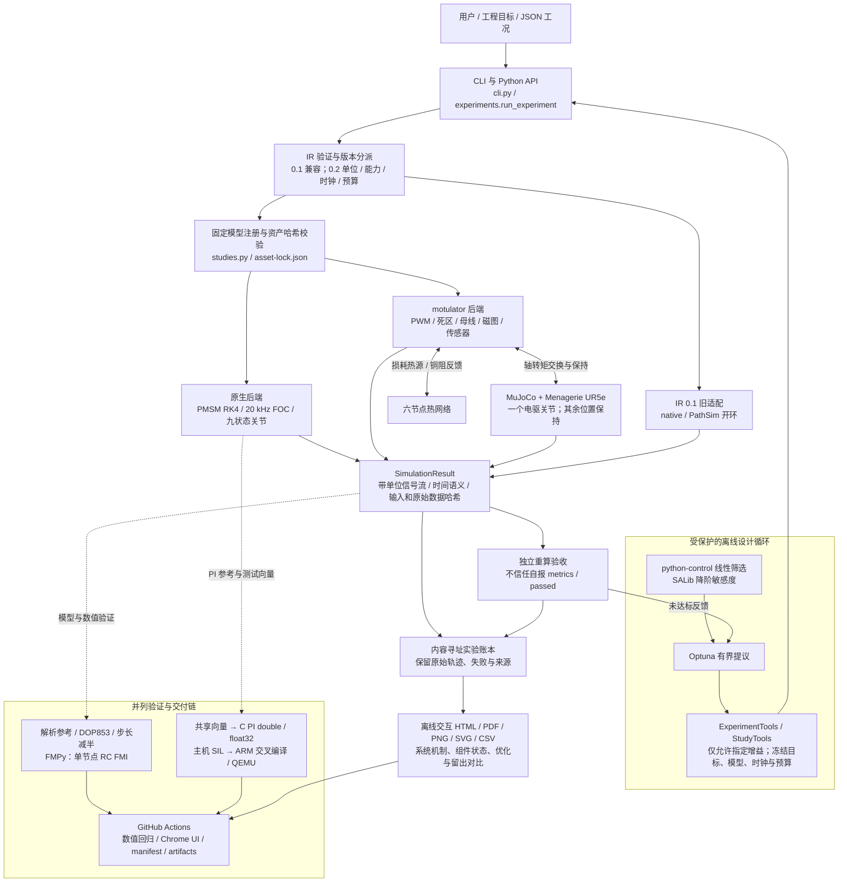
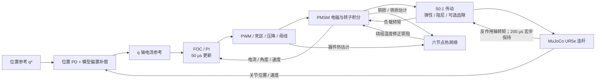
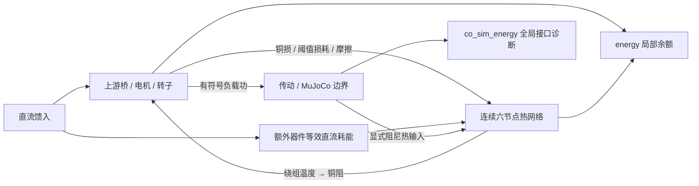
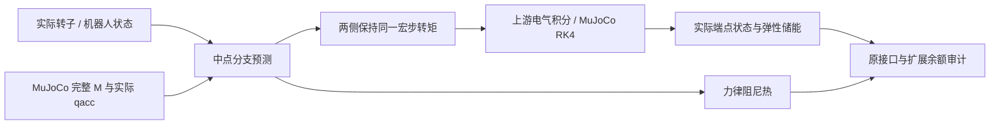

# 项目架构

更新：2026-10-23。按 main 的已实现代码梳理；软件架构图描述模块职责和数据流，
运行机制图描述 UR5e 联合模型的物理反馈，图中每个后端是可选实验路径。

[查看 / 下载 SVG 总图](architecture.svg) · [Mermaid 总图源文件](architecture-overview.mmd) ·
[运行机制源文件](architecture-runtime.mmd)

## 软件模块与证据流

优化循环通过受保护的工具接口调用统一运行器。CLI 与 Python API 共用
`run_experiment`；`ir.validate_document` 按版本分派，IR 0.2 再进入
`studies.run_study`。输入通过校验后才加载可选后端，旧 IR 0.1 仍保留独立适配。
这些是 Python 进程内模块，图中箭头不表示已部署的微服务或网络消息总线。

| 层 | 实际代码 / 目录 | 主要职责 |
|---|---|---|
| 使用入口 | [cli.py](../src/oeal/cli.py)、[experiments.py](../src/oeal/experiments.py)、examples/ | JSON 实验、CLI、Python API、版本分派 |
| 模型与执行契约 | [ir.py](../src/oeal/ir.py)、[studies.py](../src/oeal/studies.py)、src/oeal/schemas/ | 单位、时钟、预算、能力组合、固定资产校验及信号流 |
| 受保护工具 | [agent_tools.py](../src/oeal/agent_tools.py)、[study_tools.py](../src/oeal/study_tools.py) | 增益白名单、不可改目标、受信任原始流绑定与重算 |
| 设计分析 | [design_analysis.py](../src/oeal/design_analysis.py)、[设计评测](../benchmarks/validate_design_iteration.py) | python-control 降阶筛选、Optuna 有界搜索、SALib Morris |
| 原生数值模型 | src/oeal/models/、foc.py、current_control.py、transforms.py、multiphysics.py | PMSM、20 kHz FOC、坐标变换、PI、九状态关节 |
| 开源电驱与机器人 | [motulator.py](../src/oeal/backends/motulator.py)、[robot.py](../src/oeal/backends/robot.py)、refined_thermal.py | 真实开关与磁图模型、转矩交换、UR5e 连杆及六节点热 |
| 指标与证据 | metrics.py、calibration.py、benchmarks/validate_*.py、evidence_manifest.py | 独立参考、合成标定、验证、账本、输入与产物散列 |
| 报告 | reports/、[build_p6_report.py](../benchmarks/build_p6_report.py)、[UI 验证](../benchmarks/validate_report_ui.py) | 离线交互 HTML、系统状态、PDF、标准图表与 CSV |
| 固件相关仿真 | firmware/、benchmarks/validate_p4*.py、validate_p5*.py、validate_qemu_arm.py | PI C 内核、主机 SIL、ARM 编译与 QEMU；不是完整 FOC 固件 |
| 持续验证 | .github/workflows/ | Python 回归、独立数值检查、Chrome 交互、证据打包 |

## UR5e 单关节运行机制

FOC 默认按 50 μs 更新；电气求解器在控制间隔内积分。
电机与 MuJoCo 在 200 μs 宏步上交换并保持传动转矩，形成显式 Jacobi 联合仿真；
这不是统一求解器的隐式全耦合。位置 PD 使用关节位置、速度与模型偏置；
只有一个肩部关节接入研究电驱，其余五个关节采用上游位置执行器保持。
宏步、控制采样、求解波形、门极事件分别保存自己的时间语义。

原生九状态关节是另一条实验路径，其系统状态图与组件机制在
[系统图定义](../reports/system-model.json)及交互报告中展示，不等同于上述 UR5e 后端。

## 固定配置与结果接口

IR 0.2 固定注册五种配置：

| 配置 | 后端 | 主要结果流 |
|---|---|---|
| native_foc_v1 | native | control |
| native_joint_v1 | native | control |
| motulator_pmsm_v1 | motulator | control / waveforms / gates |
| baldor_map_v1 | motulator | control / waveforms / gates |
| ur5e_joint_v1 | mujoco_motulator | control / waveforms / gates / joint |

`control` 包含控制采样首末点，`joint` 包含宏步首末点；
`waveforms` 是求解采样，`gates` 是开关事件。统一结果不把这些流强行重采样为同一网格。
独立验收重算位置、电流与转矩指标；电流峰值同时检查控制采样与求解波形。
报告状态回放用于解释结果，完整原始流和哈希在 evidence 工件中。

## 已实现边界

- 目前是受限的离线优化与工具闭环，未验收在线通用 LLM 自主工程规划。
- 线性筛选和 Morris 基于降阶模型，不是全非线性系统稳定性证明或实测置信区间。
- FMI 当前仅为原始单节点 RC 热模型；没有完整关节 FMU / OpenModelica 集成。
- 默认旧模式仍采用采样热估计。可选能量模式已将额外器件热与实际直流支路匹配，
  转子摩擦和传动阻尼热有显式热端口；线性电驱局部与机器人全局分别审计。
  显式宏步的接口误差仍保留，不能宣称整个机器人系统已闭合。
- C / SIL / QEMU 覆盖 PI 内核，未覆盖完整嵌入式 FOC、ADC / ISR 或硬件实测。
- 按用户约束，仿真验收即可交付；真机部署、上电和测试由用户负责。

实际门槛、固定指标与运行证据见[阶段状态](stage-status.md)和
[统一实验与设计契约](unified-studies-design-contract.md)。

## 可选能量路径（本轮）

`studies.py` 在固定能力校验后，将 `energy_consistent=true` 传给
[backends/energy.py](../src/oeal/backends/energy.py)。该扩展添加六节点连续温度、
实际源/负载/热端口积分与等效器件直流支路，仍使用上游电磁、逆变器与机械方程。
[energy.py](../src/oeal/energy.py)从原始分账重算局部与热余额，
不信任自报 residual / passed。机器人另存执行器功、机械能、弹性储能与接口余额。

实际轨迹、余额阈值和未覆盖组合见[能量契约](energy-accounting-contract.md)。

能量审计的短时机器人轨迹为 40 ms / +0.008 rad，原受保护控制优化保留 250 ms / +0.08 rad 的独立实验目标。

## 可选耦合预测路径

[纯机械预测器](../src/oeal/coupling.py)保留原传动力律，
按冻结自由加速度解中点分支。[RobotLoad](../src/oeal/backends/robot.py)
从 MuJoCo 完整质量矩阵获取 `(M^-1)[j,j]`，而非使用对角质量倒数。
该标量和电机输出侧惯量共同决定预测转矩；实际 MuJoCo 仍独立推进。

`coupling_method`、`robot_integrator` 均为固定枚举；预测模式要求能量审计、
RK4、无齿隙/夹具。默认模式和原实验保持有效。预测、实际状态、有效惯量与回退
分别导出为带单位 `coupling` 流；独立验收不把预测中点当成实际储能。
[契约与公平对照](midpoint-coupling-contract.md)列明误差门槛和未覆盖事件。

## 秒级联合验证与报告的证据流

`joint-robustness.yml` 将 16 个固定实验分别运行，逐组保留输入、
压缩完整结果、原始单位/时钟与散列。聚合作业只读取同一工作流的产物：
重新核对固定输入，重算原目标和全量轨迹，检查步长敏感性后生成离线报告。
图表显示抽样不参与 Gate；原始关节 CSV 单独保留。

- 原九组：`benchmarks/validate_robot_endurance.py`，最长 2 s，
  沿用 PR #15 冻结设计，机器人完整能量余额仍为诊断。
- 新七组：`benchmarks/validate_joint_robustness.py`，1 s，
  包括参数/PWM/传感器组合；额外独立重算接口与扩展余额及其固定预算。
- 时间参考：`oeal.robustness`，手算非均匀采样、缺失端点与非有限输入检查。
- 新报告：`reports/joint-robustness.html` 与
  `benchmarks/build_joint_robustness_report.py`，
  浏览器验收由 `benchmarks/validate_joint_report_ui.py` 执行。
- 既有 3600 s 热网络回放单列，不把预设热源误写成实际电驱运行。
