# 项目架构

更新：2026-10-27。按 main 的已实现代码梳理；软件架构图描述模块职责和数据流，
运行机制图描述 UR5e 联合模型的物理反馈，图中每个后端是可选实验路径。

[查看 / 下载 SVG 总图](architecture.svg) · [Mermaid 总图源文件](architecture-overview.mmd) ·
[运行机制源文件](architecture-runtime.mmd) · [OpenModelica 交换链路](openmodelica-exchange.svg)

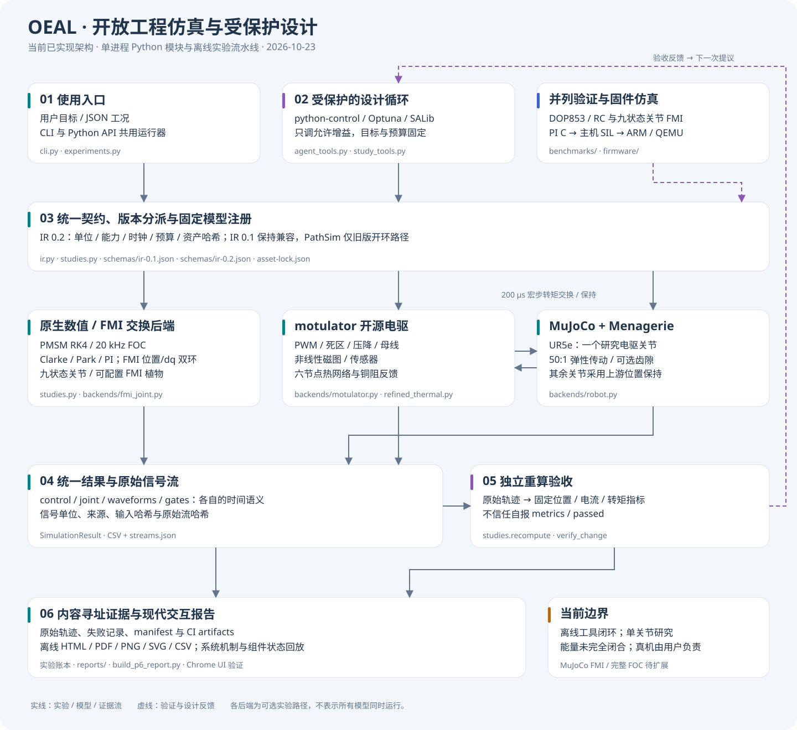

## 软件模块与证据流

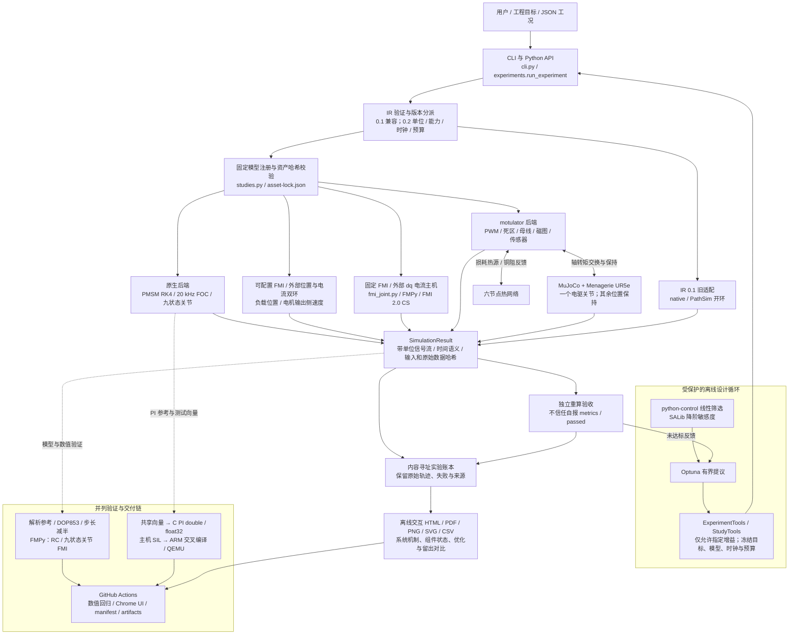

优化循环通过受保护的工具接口调用统一运行器。CLI 与 Python API 共用
`run_experiment`；`ir.validate_document` 按版本分派，IR 0.2 再进入
`studies.run_study`。输入通过校验后才加载可选后端，旧 IR 0.1 仍保留独立适配。
这些是 Python 进程内模块，图中箭头不表示已部署的微服务或网络消息总线。

| 层 | 实际代码 / 目录 | 主要职责 |
|---|---|---|
| 使用入口 | [cli.py](../src/oeal/cli.py)、[experiments.py](../src/oeal/experiments.py)、examples/ | JSON 实验、CLI、Python API、版本分派 |
| 模型与执行契约 | [ir.py](../src/oeal/ir.py)、[studies.py](../src/oeal/studies.py)、src/oeal/schemas/ | 单位、时钟、预算、能力组合、固定资产校验及信号流 |
| 受保护工具 | [agent_tools.py](../src/oeal/agent_tools.py)、[study_tools.py](../src/oeal/study_tools.py) | 增益白名单、不可改目标、受信任原始流绑定与重算 |
| 设计分析 | [design_analysis.py](../src/oeal/design_analysis.py)、[设计评测](../benchmarks/validate_design_iteration.py) | python-control 降阶筛选、Optuna 有界搜索、SALib Morris |
| 原生数值模型 | src/oeal/models/、foc.py、current_control.py、transforms.py、multiphysics.py | PMSM、20 kHz FOC、坐标变换、PI、九状态关节 |
| 开源电驱与机器人 | [motulator.py](../src/oeal/backends/motulator.py)、[robot.py](../src/oeal/backends/robot.py)、refined_thermal.py | 真实开关与磁图模型、转矩交换、UR5e 连杆及六节点热 |
| FMI 交换与主机 | [fmi_joint.py](../src/oeal/backends/fmi_joint.py) | 固定二进制校验、20 kHz 外部 dq PI、细步实际峰值和能量重算 |
| 指标与证据 | metrics.py、calibration.py、benchmarks/validate_*.py、evidence_manifest.py | 独立参考、合成标定、验证、账本、输入与产物散列 |
| 报告 | reports/、[build_p6_report.py](../benchmarks/build_p6_report.py)、[UI 验证](../benchmarks/validate_report_ui.py) | 离线交互 HTML、系统状态、PDF、标准图表与 CSV |
| 固件相关仿真 | firmware/、benchmarks/validate_p4*.py、validate_p5*.py、validate_qemu_arm.py | PI C 内核、主机 SIL、ARM 编译与 QEMU；不是完整 FOC 固件 |
| 持续验证 | .github/workflows/ | Python 回归、独立数值检查、Chrome 交互、证据打包 |

## UR5e 单关节运行机制

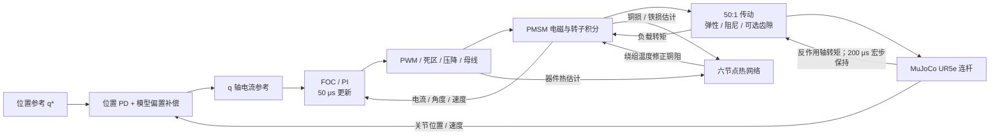

FOC 默认按 50 μs 更新；电气求解器在控制间隔内积分。
电机与 MuJoCo 在 200 μs 宏步上交换并保持传动转矩，形成显式 Jacobi 联合仿真；
这不是统一求解器的隐式全耦合。位置 PD 使用关节位置、速度与模型偏置；
只有一个肩部关节接入研究电驱，其余五个关节采用上游位置执行器保持。
宏步、控制采样、求解波形、门极事件分别保存自己的时间语义。

原生九状态关节是另一条实验路径，其系统状态图与组件机制在
[系统图定义](../reports/system-model.json)及交互报告中展示，不等同于上述 UR5e 后端。

## 固定配置与结果接口

IR 0.2 固定注册七种配置：

| 配置 | 后端 | 主要结果流 |
|---|---|---|
| fmi_joint_v1 | fmi | control / waveforms |
| fmi_servo_v2 | fmi | joint / control / waveforms |
| native_foc_v1 | native | control |
| native_joint_v1 | native | control |
| motulator_pmsm_v1 | motulator | control / waveforms / gates |
| baldor_map_v1 | motulator | control / waveforms / gates |
| ur5e_joint_v1 | mujoco_motulator | control / waveforms / gates / joint |

`control` 包含控制采样首末点，`joint` 包含宏步首末点；
`waveforms` 是求解采样，`gates` 是开关事件。统一结果不把这些流强行重采样为同一网格。
独立验收重算位置、电流与转矩指标；电流峰值同时检查控制采样与求解波形。
报告状态回放用于解释结果，完整原始流和哈希在 evidence 工件中。

## 已实现边界

- 目前是受限的离线优化与工具闭环，未验收在线通用 LLM 自主工程规划。
- 线性筛选和 Morris 基于降阶模型，不是全非线性系统稳定性证明或实测置信区间。
- FMI 包含单节点 RC 与九状态电气/双惯量/热研究关节植物模型；
  MuJoCo 整机关节 FMU 与 OpenModelica 集成仍未实现。
- 默认旧模式仍采用采样热估计。可选能量模式已将额外器件热与实际直流支路匹配，
  转子摩擦和传动阻尼热有显式热端口；线性电驱局部与机器人全局分别审计。
  显式宏步的接口误差仍保留，不能宣称整个机器人系统已闭合。
- C / SIL / QEMU 覆盖 PI 内核，未覆盖完整嵌入式 FOC、ADC / ISR 或硬件实测。
- 按用户约束，仿真验收即可交付；真机部署、上电和测试由用户负责。

实际门槛、固定指标与运行证据见[阶段状态](stage-status.md)和
[统一实验与设计契约](unified-studies-design-contract.md)。

## 可选能量路径（本轮）

`studies.py` 在固定能力校验后，将 `energy_consistent=true` 传给
[backends/energy.py](../src/oeal/backends/energy.py)。该扩展添加六节点连续温度、
实际源/负载/热端口积分与等效器件直流支路，仍使用上游电磁、逆变器与机械方程。
[energy.py](../src/oeal/energy.py)从原始分账重算局部与热余额，
不信任自报 residual / passed。机器人另存执行器功、机械能、弹性储能与接口余额。

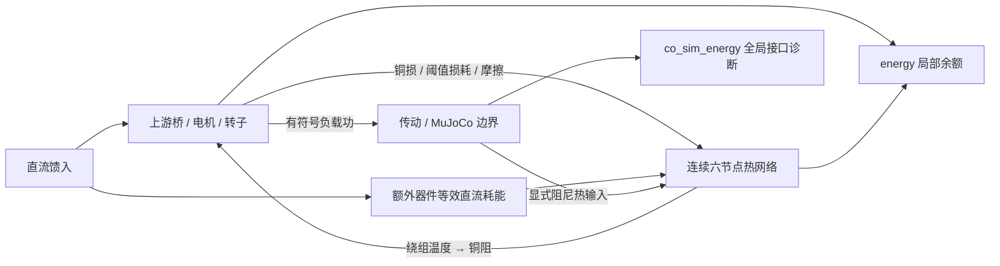

实际轨迹、余额阈值和未覆盖组合见[能量契约](energy-accounting-contract.md)。

能量审计的短时机器人轨迹为 40 ms / +0.008 rad，原受保护控制优化保留 250 ms / +0.08 rad 的独立实验目标。

## 可选耦合预测路径

[纯机械预测器](../src/oeal/coupling.py)保留原传动力律，
按冻结自由加速度解中点分支。[RobotLoad](../src/oeal/backends/robot.py)
从 MuJoCo 完整质量矩阵获取 `(M^-1)[j,j]`，而非使用对角质量倒数。
该标量和电机输出侧惯量共同决定预测转矩；实际 MuJoCo 仍独立推进。

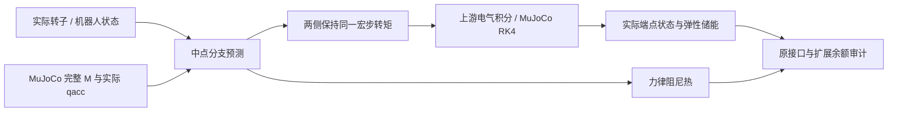

`coupling_method`、`robot_integrator` 均为固定枚举；预测模式要求能量审计、
RK4、无齿隙/夹具。默认模式和原实验保持有效。预测、实际状态、有效惯量与回退
分别导出为带单位 `coupling` 流；独立验收不把预测中点当成实际储能。
[契约与公平对照](midpoint-coupling-contract.md)列明误差门槛和未覆盖事件。

## 秒级联合验证与报告的证据流

`joint-robustness.yml` 将 16 个固定实验分别运行，逐组保留输入、
压缩完整结果、原始单位/时钟与散列。聚合作业只读取同一工作流的产物：
重新核对固定输入，重算原目标和全量轨迹，检查步长敏感性后生成离线报告。
图表显示抽样不参与 Gate；原始关节 CSV 单独保留。

- 原九组：`benchmarks/validate_robot_endurance.py`，最长 2 s，
  沿用 PR #15 冻结设计，机器人完整能量余额仍为诊断。
- 新七组：`benchmarks/validate_joint_robustness.py`，1 s，
  包括参数/PWM/传感器组合；额外独立重算接口与扩展余额及其固定预算。
- 时间参考：`oeal.robustness`，手算非均匀采样、缺失端点与非有限输入检查。
- 新报告：`reports/joint-robustness.html` 与
  `benchmarks/build_joint_robustness_report.py`，
  浏览器验收由 `benchmarks/validate_joint_report_ui.py` 执行。
- 既有 3600 s 热网络回放单列，不把预设热源误写成实际电驱运行。

## 控制器估计与真实对象的分离

IR 0.2 新增可选 `controller_parameters`，只供给线性电驱的 PI、
解耦/反电势和外环转矩到电流换算；真实电机方程、铜耗、磁能以及
温度反馈使用 `model.parameters`。实际 R25 与名义 R 明确单列，
默认两者相同，显式覆盖后不随物理参数或温度变化更新名义值。

`oeal.trajectories.joint_reference` 产生运行时目标，
保护验收在 `studies.recompute` 中单独用向量公式重算循环参考，
检查完整宏步流的峰值和 RMSE。未给周期时保持原斜坡。

循环工作流每组分成仿真/序列化和独立重读审计两个进程。
审计忽略生产者 metrics，重算完整原始流，检查参数隔离、端点储能、
能量账本与篡改参考；聚合阶段核验同次运行的文件散列、固定输入和
宏步位置差。完整电磁 JSON 仍保留，避免单一聚合作业反复串行扫描。

## FMI 植物模型的交换边界

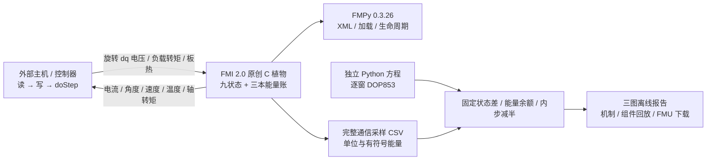

[原始 C](../firmware/fmi/joint.c)使用单体同步 RK4，不通过显式宏步连接 MuJoCo；
因此其全域能量余额不能替代 UR5e 后端的接口诊断。
通信输入在**转子 dq 坐标**保持，不能与原生 FOC 的静止 alpha/beta 保持混用。
内部参数为固定研究值，外部输入是 4 个明确端口。
IR/CLI/API 与受保护工具已通过 fmi_joint_v1 接入外部 20 kHz 电流主机；
七个电机参数与外部位置环已由 fmi_servo_v2 接入；
OpenModelica固定植物的ModelExchange导出与FMPy导入已独立验证，见下文；
传动/热参数配置、机器人/六节点热适配与控制器/事件交换尚待实现。
[契约](joint-fmi-contract.md)与[独立验证](../benchmarks/validate_joint_fmi.py)分别留存。

## FMI 主机的控制窗与细步证据

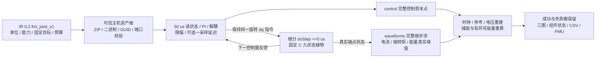

预算包含 C 每 RK4 子步的四阶段导数与末态域检查，共五次 RHS。
doStep 通信细步与控制周期明确分开；最后输出点不额外更新控制或积分。
独立 DOP853 逐控制窗重放实际施加电压，并用独立 PI 算术重建主机指令。
[固定契约](fmi-host-contract.md)先于参考与主机实现，既有五个配置继续共用原接口。

## 可配置植物与反馈修订 B

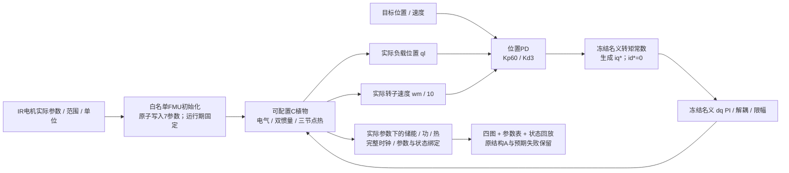

原结构A使用负载侧速度作微分反馈。理想电流环双惯量的独立Routh-Hurwitz检查
揭示其结构性问题；修订B采用电机输出侧速度，位置反馈仍在负载侧。
该判据是限定降阶分析，不能代替完整采样非线性联合模型的固定Gate。
[修订契约](fmi-servo-contract.md)和手算参考先于反馈修改提交。
旧 fmi_joint_v1 继续使用原18端口与原二进制；
新版25端口中的18..24为七个固定电机参数。

## OpenModelica 编译与 ModelExchange 交换验证

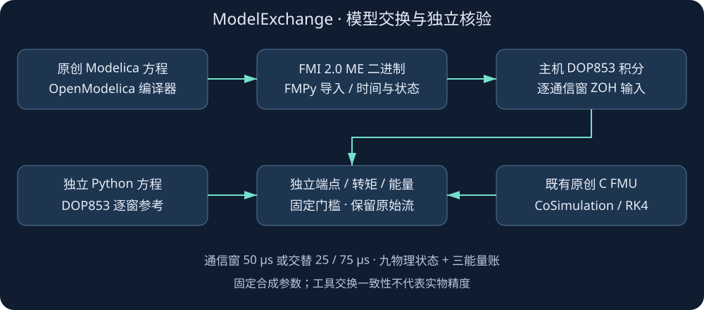

[Mermaid源文件](openmodelica-exchange.mmd)与[冻结契约](openmodelica-interop-contract.md)配套。
原创Modelica源码经固定OpenModelica镜像实际导出ME FMU；
FMPy按变量名解析端口和编译器自己的连续状态顺序。
主机每个零阶保持通信窗设置时间/状态、调用生成导数，并用DOP853积分。
ModelExchange本身不提供积分器；原C模型的CoSimulation仍使用自身RK4。

全部12输出对照独立Python方程，九物理状态再对照C FMU；
实际状态重算轴转矩、储能和三本有符号能量账。
这是独立基准链，不加入IR注册或允许实验指定任意FMU路径。
报告保留三方轨迹、组件回放、全量CSV、编译镜像摘要及源码/二进制散列。

## MSL 六节点热组件交换路径

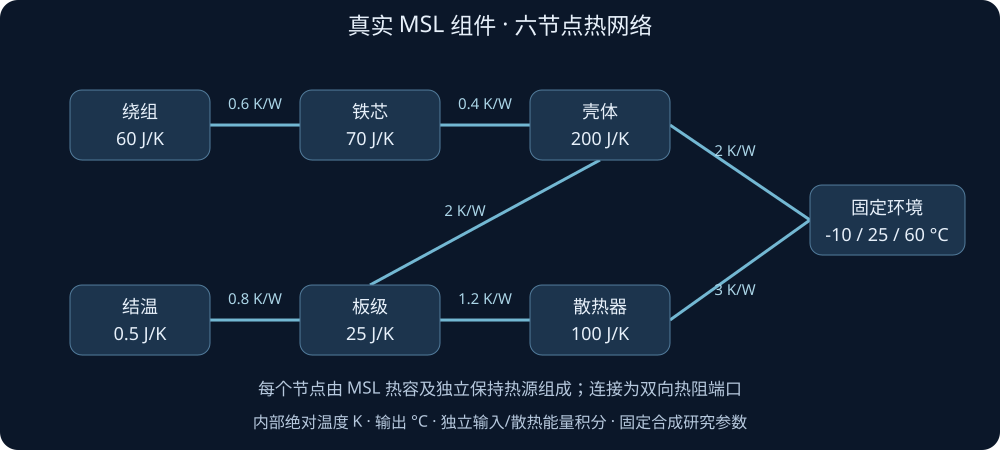

[Mermaid源文件](msl-thermal-network.mmd)与[实现前契约](msl-thermal-contract.md)对应。
此路径实际使用MSL4.0.0的6热容、7热阻、6保持热源和1固定环境组件，
不是将手写ODE重新命名为MSL。Modelica内部K，FMI输出摄氏度，
参数仍为固定合成值；温差K、热流W、能量J。

六路输入分别连接六个热容端口；两条环境热阻接收壳体/散热器热流。
输出六温度、五内部有符号热流、环境总热流和输入/散热积分。
FMPy加载真实ME二进制，主机DOP853逐保持窗推进；
独立Radau物理方程和原生ThermalNetwork矩阵指数提供两路全轨迹参考。

独立余额以真实温度重算热储能，连同积分账、方向热流、完整CSV/时钟接受固定Gate。
四图报告在实际连接图上展示温度/流向，六张卡说明加热/冷却/近稳态及净热流。
本轮为独立一小时预设损耗回放；尚未把电机/PWM或MuJoCo损耗实时连到该FMU。
原六节点原生热后端与七个IR配置保持，未开放任意实验路径加载外部代码。

## 实际电驱损耗与 MSL 的连续联合反馈

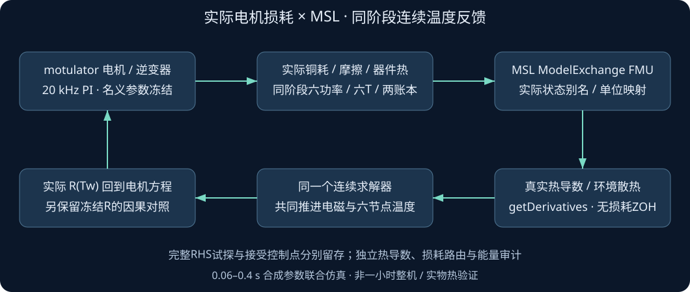

[Mermaid源](msl-drive-network.mmd)与[冻结契约](msl-drive-contract.md)对应。
在原生能量子系统增加可选可信Python thermal_provider；默认None不改变原轨迹。
提供方只替换六热导数及环境热流，不替换上游电机、逆变器、控制器或积分器。
每次RHS按实际温度/热功率/累计热输入与散热账投影MSL的8连续状态，
按ModelStructure、实际编译别名、valueReference与单位解析FMI坐标；
生成导数与电磁状态由同一连续求解器推进。

实际绕组温度在同阶段更新R(Tw)，并用于真实铜耗；
PI的名义R/L/磁链仍冻结。冻结实际R对照保留热积分，以检验温度反馈因果作用。
真实铜耗进绕组、摩擦进机壳、桥压降及额外DC支路耗散进结温；
不重复计热，不把源功按余额反推。

全部RHS试探流单独保存为gzipCSV并逐行独立审计；
接受控制采样单调，求解器试探/回退不要求单调。
原生配对、细步、实际电阻恢复、本地能量和错误路由/漏记支路/冻结R副本均接受固定Gate。
报告把电驱、全部热节点、实际R、源功/余额四类状态与五图相连。
当前仅为无事件线性单惯量短时联合验证；没有把它注册成新的任意资产IR后端。

## 非线性对流、辐射及三支路散热账

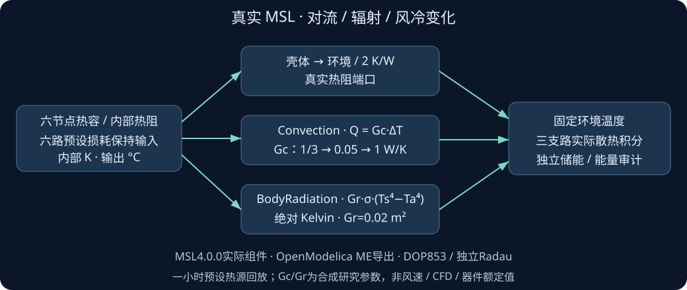

[Mermaid源](msl-cooling-network.mmd)与[契约](msl-cooling-contract.md)对应。
独立OEALMSLCooling FMU保留六热容与五内部热阻；
壳体到环境仍为2K/W，散热器到环境改为真实MSL Convection/BodyRadiation并联。
Convection使用外部Gc·ΔT；BodyRadiation使用Gr·sigma·(Ts_K^4-Ta_K^4)。
Gc是外部等效W/K输入、Gr是初始化前的有效面积m²，均为合成研究参数。

六温度+输入热积分+三条真实环境散热积分共10连续状态，
环境总能量只作三支路之和；独立审计从真实温度重算储能和各热流。
FMPy加载ME二进制，主机DOP853与独立Radau逐边界分段对照；
关闭辐射时对照原生矩阵指数；Gc改变时保留真实保持窗和热流跳变。

报告在六节点图中显示对流/辐射分支及方向、Gc/Gr、三支路累计能量、
风冷减弱/恢复和全部温度状态，配套五图与完整CSV。
该独立一小时热源回放没有修改旧线性FMU/电驱适配器或IR注册；
新非线性边界的实际电驱联合接入与长时整机验证仍待推进。

## 实际电驱与非线性MSL散热联合

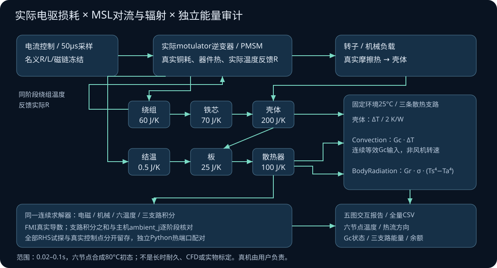

[联合机制源图](msl-cooling-drive-network.mmd)与[实现前固定契约](msl-cooling-drive-contract.md)对应。
可信热提供方通过energy_state_names显式声明三条散热能量状态，
与旧FMU用于XML元数据的state_names分开，旧8状态接口继续兼容。
只有新提供方指定六节点80°C合成初态；默认路径仍为25°C。
储能与热余额使用相对初态的变化，不把初始储热当损耗或源能。

同一motulator求解器在每个RHS阶段把真实热输入、六温度、输入累计热与三支路积分
投影到原10状态OEALMSLCooling FMU，真实MSL返回六热导数及三支路功率。
主机三条积分之和与ambient_j同时核对；没有热子步或损耗保持回放。
绕组温度在同阶段反馈实际电阻；控制器名义参数仍冻结。
独立Python热端口按同输入、同初态、同电机模型配对，完整RHS试探独立重算。
它验证不同热端口实现，不声称两个独立电机模型。

联合运行范围为0.02–0.1s热初态实验，单惯量、固定环境、平均/PWM与无事件ME模型。
连续变化Gc是合成W/K输入，不是转速或风机故障保护事件。
长时联合验证、整机MuJoCo与保护事件仍待推进；真机由用户负责。

## 环境和六节点初温配置与秒级联合

[可配置联合机制图](msl-configured-drive-network.svg)对应
[实现前契约](msl-configured-drive-contract.md)。
可信MSLCoolingDrive对象增加关键词ambient_c和initial_temperatures_c；
固定环境及Gr在FMI初始化前设置，六节点实际初态在初始化后投影，
三支路与输入热积分均从零开始。环境、初温、Gr的类型/有限性/维度/范围在读FMU前校验。
主机储热参考仍为25°C，能量余额使用相对真实初态的变化；
壳体/对流/辐射散热按配置环境分别核对。

独立Python热端口使用同一配置和六个实际状态，所有RHS、能量、实际R及完整控制轨迹配对。
冷启动实际电驱最长1s，另有非均匀初温、−10°C PWM、60°C回馈，
以及60°C暖环境向25°C节点输入热量和无热平衡的真实FMU点检查。
报告选择工况时同时更新环境、每个节点初态/当前温度、Gc和三条热流/积分。
这些是固定合成参数下的秒级联合验证；七IR注册、RC参数、MuJoCo整机与保护事件范围仍按原路线图。

## 六热容、五内部热阻和壳体支路配置

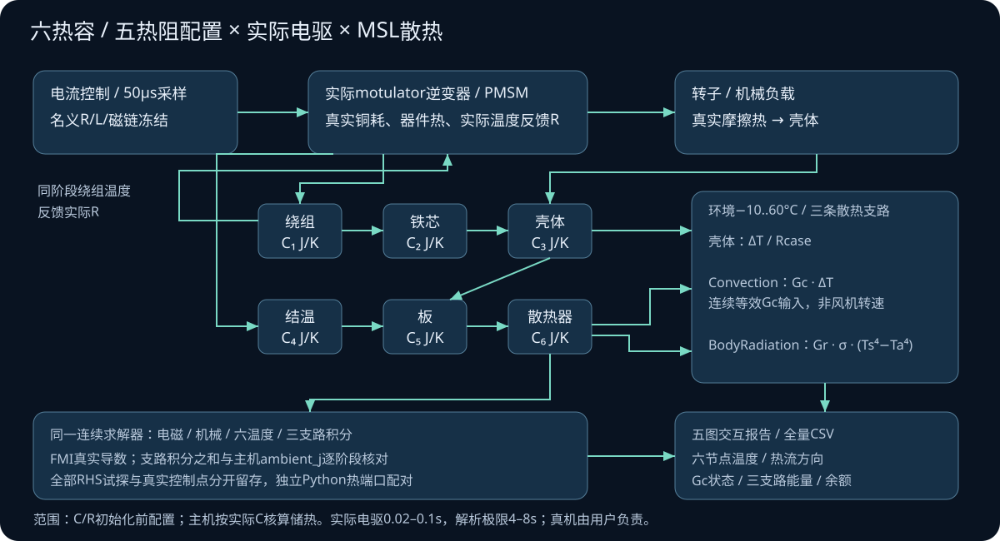

[参数与复现](msl-rc-configuration.md) / [实现前契约](msl-rc-contract.md)。
新增独立OEALMSLParametric FMU，初始化前把实际C/R/Rcase传给MSL组件，
初始化后读取根参数及实际组件导出的12项参数观测值。
真实电驱与参数化热状态仍在同一连续求解器积分；
可信提供方声明实际C，主机构造时复制只读，并据此计算储热及功率恒等式。
旧提供方未声明C时继续原算法；元数据标明原生导热矩阵仅为备用。

默认新资产与旧固定MSL资产的电驱/温度/三支路能量逐点配对；
不同C/R通过全RHS独立方程、实际储能和故障副本核对。
零输入Gr0的矩阵指数及双C的时间/散热积分缩放是独立热解析极限。
报告显示六C、五R、Rcase、初态/当前温度、实际R与三散热去向。
本轮实际电驱0.02–0.1s，零输入解析4–8s；不替代此前1s或长时整机验证。

## 六节点合成辨识：训练隔离、参数冻结与预测

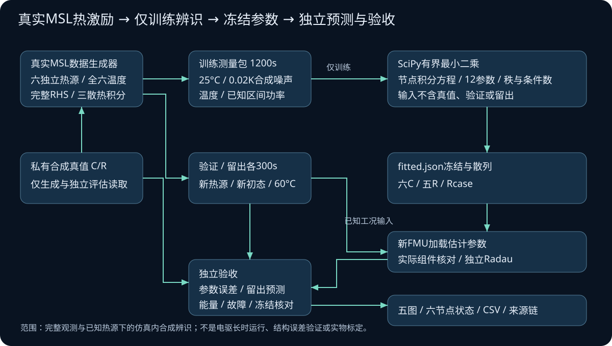

[固定契约](msl-identification-contract.md)和[复现说明](msl-identification.md)对应。
真实MSL生成六独立热源及六温度轨迹，三组测量和真值分别存储；
拟合进程仅读取train测量及公开边界，以节点能量积分构建设计矩阵。
SciPy1.15.3有界求解六C、五G及Gcase；秩/条件数检查在输出前拒绝不足激励。
不将真值、验证或留出作为fit_network输入。

参数JSON及训练数据hash冻结后，新FMU读取估计C/R，
在新初态/热源和60°C留出下预测。独立Radau区分数值交换误差，
合成真值、公开默认基准和故障副本负责独立评估。
报告将数据使用边界、十二参数与六节点运行状态连起来。
本轮全观测/已知独立热源的热辨识，不代表电驱长时、结构不匹配或实物标定。

## 辨识可靠边界：扰动、训练冻结与留出判据

[固定契约](msl-identification-robustness-contract.md) /
[20组结果](msl-identification-robustness.md)。

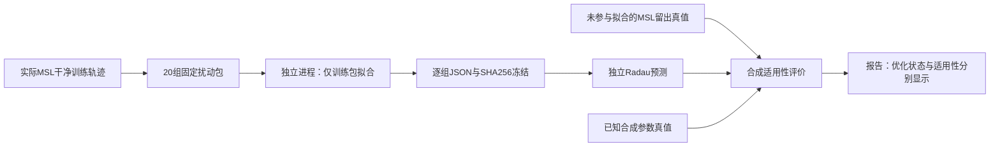

四种子/三噪声、偏置、功率记录错误和退化观测不改动原拟合器或物理模型。
所有成功拟合都执行300s预测，失败值不被筛除。
逐组新预测用独立方程，不冒充新FMU实例；原新FMU基准在同工作流重跑。
报告按案例播放六温度、热源、内部温差/R及三条环境散热机制，
拒绝拟合的案例隐藏运行状态。
该评价依赖合成真值；发现恒温噪声满秩但预测失败，且共模偏置仍能过门槛。
因此后续的无真值激励质量/噪声处理与稀疏观测仍是独立工作项。

## P7-A可选有限元链路：首个制造解

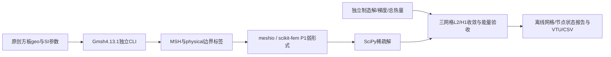

[实际基准](p7-fea-baseline.md)为可选benchmarks环境，不进入主包依赖或主IR。
边界标签/拓扑/单位与网格重现先检查，反力余额与直接梯度通量分别核验。
只验证二维均匀稳态制造解；当前未把FE参数送入电驱或生成ROM。

## 双材料FE：物理标签、混合边界与界面审计

[固定契约](p7-layered-contract.md)和[验证范围](p7-layered.md)对应。

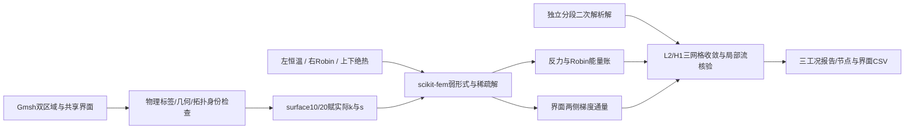

共享节点保证离散温度连续，不保证重建通量精确连续。
反力余额、直接梯度和独立解析功率分别保留；负向外功率表示边界入热。
尚无接触热阻、瞬态或电磁损耗映射，不更改主IR或电驱。

## 原温度不变的RT0通量后处理

[方程/固定门槛](p7-conservative-contract.md) /
[实际结果与全域取舍](p7-conservative.md)。

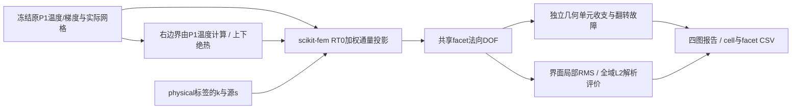

解析热流不进入投影。RT0法向连续来自空间结构，
积分准确也受边界/源约束，不能单独作为准确性证明。
本轮界面局部精度改善，但全域通量L2反而更大；
原P1梯度保留，尚不作为主IR或电驱的替代温度/通量后端。

## BDM1增量：相同温度来源，更丰富的通量与边界空间

[固定契约](p7-bdm-contract.md) /
[实际三方比较](p7-bdm.md)。

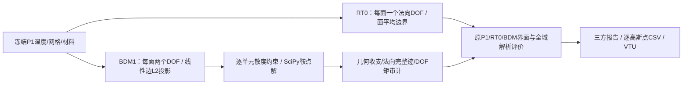

解析参考不进入投影；原温度和旧算法不被覆盖。
本制造解的方向性仿射通量可被BDM1表示，但不完整落在最低RT0空间；
右边界也从面平均扩为同一P1数据的线性迹，需同时披露。
局部守恒与全域精度均单独验收，尚不作为主IR/电驱默认后端。
