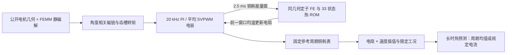

# P7 仿真研究里程碑：公开电机电磁—电驱—定子热链

冻结日期：2026-11-09（北京时间）。代码基准 [b879184](https://github.com/lse872317312010/open-engineering-agent-lab/commit/b879184bf3ff086b522b8c9417142c591f9bfff2)，其文件树与完整验收提交 [a39822e](https://github.com/lse872317312010/open-engineering-agent-lab/commit/a39822eb1595d4392f81618924d448a9d206ae4d) 一致。证据等级：**模型仿真**。这是一组 P7 研究增量，整体 Gate B/C/D 尚未完成；用户负责真机。

## 系统与数据流

热反馈遵循先完成窗口、再更新下个窗口电阻的因果顺序。电阻系数、热材料和边界为合成参数；同几何指当前二维定子截面，不含端部、转子和接触层。

## 验证口径

| 能力 | 实际验证及结果 | 范围 |
|---|---|---|
| 短脉冲 ROM | 原 22 状态短时全场相对差约 38.7%；补充算子方向的 33 状态在 12 个原工况最大 1.188%，9 个新留出最大 2.946% | 对同网格、同时间离散 FE，非实物总误差 |
| 短时电热反馈 | 四组环境/转向各 50 ms，20 kHz 电流控制与 2.5 ms 热窗；全场最大相对差 1.188%，联合能量余额 ≤8.59e-13 J | 电气和机械为仿真，合成 R(T)，自热电阻变化只有纳欧量级 |
| 长时热反馈 | 3 条 24,000 s 规定电流包络，最大同离散 FE 全场差 4.353 µK；0.5 s 细化和前 1,200 s 的 400 Hz 回放通过 | 长时采用理想保持的规定电流，不是持续运行 20 kHz FOC |
| FOC 损耗表 | 18 个周期建表点、8 个速度/电阻/初角留出；周期最大相对差 0.002370% | 固定同向 ±0.5 A 参考、规定速度；R=0.3–0.42 Ω、速度幅值 0.5–2 倍 39.269908 rad/s，不外推 |
| 加减速留出 | 两条 600 ms 规定速度轨迹，后 400 ms 最大累计铜耗差 0.008067%，最大 2.5 ms 窗差 1.575% | 外部主机规定机械速度；起动阶段不属于周期表评分区 |
| 长时表驱动热预测 | 4 条 24,000 s 周期均值热应用，表与理想恒流模型分别反馈 | 两模型之差是模型比较，不是实际温度误差，也不是数小时持续 FOC |

[完整专项运行](https://github.com/lse872317312010/open-engineering-agent-lab/actions/runs/42489424454)通过，Python 3.10/3.11/3.12 的 [CI](https://github.com/lse872317312010/open-engineering-agent-lab/actions/runs/42489424412)通过；专项为 **429 项通过、23 项可选检查跳过**。最初铜耗回放版本存在 Ruff 行长问题及功率图窗口时钟错误；后续已修复，最终固定提交完整重跑。没有以跳过项声明后端通过。

[下载完整仿真证据包](https://github.com/lse872317312010/open-engineering-agent-lab/actions/runs/42489424454/artifacts/13621047563)（约 676 MB，GitHub Actions 标示有保留期限）。包内含有限元/ROM 原始场、损耗表、轨迹、图、清单与哈希；ZIP SHA-256：`2ed1575b8d59b530305830f5f58b9d5c16c3f1eea504cd0e356a699a078dbcee`。上游 [2026-11-05 研究快照](https://github.com/lse872317312010/open-engineering-agent-lab/releases/tag/snapshot-2026-11-05) 为永久发布入口；本次完整证据包仍受 Actions 保留期限约束。

## 后续边界与路线

- 电磁结果主要由同一 FEMM 二维静磁链产生；缺少独立电机场求解器或公开物理基准对照，材料出处和公开模型轴向参数问题仍需解决。
- 热模型采用固定空间铜耗源与合成材料/边界；铁耗、器件损耗、端部、转子、接触与真实传感器尚未覆盖。
- 固定电流参考和规定速度的周期表只在声明域内有效；不同参考幅值、阶跃暂态、自由机械负载与长时实际 FOC 须单独验证。已有下一阶段契约尚未实现，不计入本里程碑。
- 完整固件 SIL/PIL、跨进程恢复、保护策略及工程全工况尚待推进；真机不阻塞仿真验收。

详细方法：[短时 ROM](p7-stator-fast-rom.md) · [温度反馈](p7-temperature-feedback.md) · [长时热反馈](p7-feedback-endurance.md) · [固定速度损耗表](p7-foc-loss-map.md) · [速度—电阻损耗表](p7-speed-loss-map.md) · [路线图](p7-open-fea-roadmap.md)。
