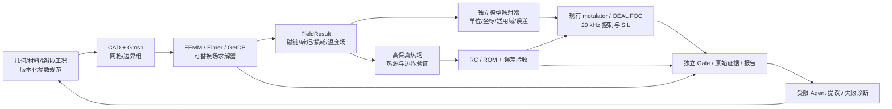

# P7：开放有限元与电机—控制—热—固件数字研发闭环（研究计划）

> 提出：2026-10-29；状态：**总体计划推进中；首个P7-A制造解基准已独立验证，其他子项仍待评测**。
> 上位目标：[总路线图](roadmap.md) · [现有软件架构](architecture.md) · [证据索引](stage-status.md) · [仿真交付范围](acceptance-scope.md)。
> 定位：与 ANSYS / Maxwell / Mechanical / Fluent 的**可证实、限定场景对比**，不是承诺全面替代 ANSYS，也不是重新开发通用有限元求解器。

## 1. 北极星目标与非目标

在开放、可迁移的 Python + AI Agent 研发环境中，以**同一台 PMSM/关节模组**为贯穿对象，构建可审计数字线程：

1. 参数化几何 / 绕组 / 材料与工况；
2. Gmsh 等开放网格，FEMM / Elmer / GetDP 等真实有限元求解器；
3. 电磁计算输出磁链、增量/割线电感、转矩/转矩脉动、反电势、可追溯损耗（仅在物理模型支持时）；
4. 把有限元结果映射至现有 OEAL 的 PMSM/FOC、motulator、关节和 FMU 模型，保留坐标、单位、温度、时钟和适用范围；
5. 将铜耗/铁耗/器件损耗按明确的物理热源映射到高保真热传导/对流模型，提取 RC/ROM（pyMOR 等）；
6. 验证 ROM 在目标计算环境下的 **400 Hz 在线状态更新**与 20 kHz FOC/SIL 的联合仿真接口（更新频率不等于温度估计准确度）；
7. 对照独立解析基准、网格/时间收敛、公开数据及**可获得且合法许可的**商业求解器结果，保留完整证据；
8. 基于冻结验收器，允许 Agent 提议设计/网格/工况，自动运行与修复，但**不得修改黄金数据或通过门槛**。

**目标不是：** 复制 ANSYS GUI、通用 FEM、全领域 CFD、整个 Simulink、宣称工业认证；未经真实样本不能声称结温预测达到物理实测精度。真机数据、PIL/HIL 由用户提供或执行，**不作为 P7 仿真交付前置条件**。

## 2. 现状与增量边界

截至本计划编写时，仓库已有 20 kHz FOC、原生/开源电驱、九状态关节、FMI/OpenModelica、连续六节点热网络、合成热参数辨识、受保护设计、C PI SIL/QEMU、证据和报告链。

**尚未验证：** Gmsh 生产级网格工作流、FEMM/PYLEECAN 与 Elmer/GetDP 的真实有限元接口、可复现电机 FE→FOC 参数链、实物几何的 3D 热/结构 FE、与 ANSYS 的同条件基准，以及 FE→ROM→400 Hz 在线模型的端到端误差/性能。

P7 必须作为**独立、可选、版本钉住的后端路径**逐项加入；不得把现有六节点合成 RC 模型或 FMI 模型重新命名为 FEM，也不得默默改变现有七种 IR 0.2 配置的默认语义。

## 3. 组件候选与决策方式

| 工程阶段 | 优先候选 | 首次纳入 | 重点评测与边界 |
|---|---|---|---|
| 参数化几何与 CAD | OpenCASCADE / FreeCAD | P7-A | STEP 与程序化几何、拓扑修复、单位与可复现性 |
| 网格 | Gmsh（Python API） | P7-A | 单元质量、网格密度、收敛和边界标记 |
| PMSM 2D 电磁 | PYLEECAN + FEMM | P7-B | 2D 非线性磁路、磁链/转矩/反电势；FEMM Windows/兼容环境依赖 |
| 电磁 3D/多物理 | Elmer / GetDP | P7-C 候选 | 非线性材料、旋转、涡流、热场、并行性能及工作流成本 |
| 纯物理FEM验证 | Gmsh + scikit-fem | P7-A首个基准 | 已验证原创二维稳态制造解；不代表实物热场或Elmer集成 |
| 热场 / 固液共轭换热 | Elmer；OpenFOAM（后续） | P7-C | 导热与温度相关参数优先；CFD 延后 |
| 结构与模态 | Code_Aster / CalculiX | P7-E | 接触、变形、模态与网格转换 |
| 控制及电机系统 | 现有 OEAL / motulator / FMI | 复用 | 不平行复制既有被控对象和求解器 |
| 降阶 / 在线估计 | pyMOR / SciPy | P7-D | ROM 误差界、推理性能、热源与边界变化 |
| 实验编排 / 多学科优化 | 现有 IR/Agent 工具；OpenMDAO 作为候选 | 按需 | 后端可替换、安全沙箱、预算与独立 Gate |

各候选先记录上游版本/commit、许可证/SPDX、分发与链接义务、可编程 API、安装环境、支持的物理模型、可替换性及复现命令，作出 `adopt / adapt / reference-only / reject` 决策。**Gmsh / GetDP 的 GPL 及例外条款、FEMM 的平台/分发约束、公开数据集的非商业限制，需要逐项审核；不能仅因代码公开就假定可商用。**

## 4. 数字线程与适配契约（建议；不得提前宣称已实现）

后续 IR 提案建议新增 *可选* `FieldExperimentSpec`/`FieldResult` 与 `ModelReductionResult`，在独立 ADR 和 JSON Schema 测试通过后才合入主 IR。最小证据字段：

- 几何/绕组/材料版本与 SHA256；坐标系、旋转正方向、极对数、相序、单位（SI）；
- 网格文件/单元类型/节点数/质量/尺寸分布及边界组；
- 求解器版本、构建/镜像摘要、数值容差、非线性迭代、时间步长、线程/CPU/RAM；
- 电流幅值定义（峰值/RMS、dq/相量）、激励相位、温度/磁化状态、位置/转速扫描；
- 原始场与计算得到的磁链/转矩/损耗，插值/拟合系数、非线性与温度适用范围；
- `source_kind` 区分 `analytic` / `synthetic` / `open_dataset` / `commercial_solver` / `physical_measured`；已有 `Evidence` 等级契约保持兼容；
- 独立验收器版本、固定阈值、失败记录、原始文件摘要、许可归属。

**物理注意：** `R_s` 主要由铜线几何、电阻率及温度决定，不可从单次静磁 FE 直接认定；`L_d/L_q` 应声明工作点和采用的割线/微分定义；反电势、平均转矩、转矩脉动及铁耗/涡流损耗必须使用各自适当的时间/运动/材料模型；磁链需统一三相↔dq 的幅值和变换约定；空间网格收敛不替代时间/耦合收敛。参数映射不能无条件以常数覆盖现有非线性磁图。

## 5. 可执行里程碑、冻结门槛和依赖

### P7-A：组件复现与纯物理基准（P0 优先级）

交付：候选许可证/环境 ADR、容器/Windows Worker 运行策略、Gmsh 参数化几何和最小网格样例、独立解析/制造解校验、可重跑的 CI smoke（外部大型依赖可采用单独工作流）。

**Gate A：** 从干净环境生成同一输入的网格与可追溯结果；验证单位和边界组；至少三档网格做收敛检查（验证误差趋势，不以“数值相同”作条件）；记录版本、CPU/内存、原始场文件与产物 hash。不得将只产生网格标为已完成 FE 求解。

### P7-B：同一 PMSM 的 2D 电磁场→FOC（首个核心 Demo）

交付：PYLEECAN/FEMM 真实求解器导入；电机参数/材料/绕组/激励固定；开路反电势、转矩/磁链/电感工作点扫描；导出带单位参数表；映射到现有 OEAL/motulator 的控制与动态模型。

**Gate B：** 附真实外部求解器运行证据、工况和至少三档网格/角步收敛；参数映射经过符号、单位和峰值/RMS 交叉测试；和独立参考/公开案例对照且**事前固定逐指标容差**；同一 PMSM 的 FOC 案例可复现，并有失败工况。不得将合成参数当作电磁 FE 的计算结果。

### P7-C：高保真损耗与热传导（随后）

交付：将铜耗/已建模铁耗/器件损耗按有符号、无重复热源映射到导热 FE；建立绕组/器件/PCB/硅脂/壳体的分区材料和接触热阻；至少一条与现有六节点热网络的独立参照。

**Gate C：** 原始损耗和热流积分能量守恒；至少三档网格、时间步收敛；热边界/接触热阻做灵敏度；无物理实测时仅宣称合成或公开数据集验证，不报告真实 MOSFET 结温精度。

### P7-D：ROM → 400 Hz 温度估计 → 20 kHz FOC/SIL

交付：有状态空间或 RC 网络的可导出 ROM、模型有效域、冻结训练/验证/留出拆分、400 Hz 热状态更新与 20 kHz 控制时间基准的同步接口；按计算预算测试宿主与目标可移植 C 参考（可选）。

**Gate D：** 独立留出温度轨迹 RMSE/峰值误差与全阶模型对照，事先冻结阈值；多温度、热源及接触热阻扰动的域内/域外失败样例；性能记录 p50/p95/峰值耗时与 CPU、内存；通过 SIL 不等于板端硬实时或物理结温精度。

### P7-E：可选扩展结构/CFD 与商业对比

交付：Code_Aster 的结构应力/模态，OpenFOAM 的共轭换热，仅在前几阶段通过后评估。商业 ANSYS Maxwell/Mechanical/Fluent 需要合法许可与同条件算例才进行实测比较。

**Gate E：** **同几何、材料、边界、求解目标、精度约束、CPU/线程、内存/硬件**对比；公开完整矩阵、误差/收敛曲线、墙钟时间和峰值内存，不以宣传速度声称优劣。缺乏商业工具访问时标记“待比较”，不阻塞开源模型自身验收。

## 6. 公开基准与实测数据的职责

优先研究 CREATOR 电机公开数据及其他合法公开的 PMSM 数据，评估几何、磁性材料、绕组、转矩/反电势/损耗是否足以复现具体试验。若数据采用 CC BY-NC 类限制，**研究中严格遵守条款，不能随意随仓库再分发或用于商业结果集**。引用原始作者、DOI、工况、版本与授权，不把“有公开测量”当作所有仿真预测均受实测验证。

验证分三条明确标签：**解析/制造解**（数学正确性）、**第三方求解器交叉比较**（数值一致性）、**公开或用户实测**（物理预测有效性）。依赖 ANSYS 的对照属于可选外部参照，ANSYS 不是唯一真值。

## 7. 风险清单与回退策略

| 风险 | 缓解/回退 |
|---|---|
| FEMM Windows 依赖或许可证不兼容 | 独立 Windows Worker；Linux/Elmer/GetDP 探针；不污染 Python 主包 |
| 电磁运动和铁耗建模不足 | 分离静磁/瞬态求解能力声明，不拼凑虚假损耗 |
| 多场映射误差、热源重复计入 | 明确控制体和有符号能量账，独立重算 |
| CAD/网格不可复现 | STEP + 几何脚本 + Gmsh 物理组 + 网格收敛 CI |
| 耗时/CI 不稳定 | 轻量解析与 smoke 每次 CI；HPC 长任务独立可重跑并锁版本 |
| 数据集非商用、材料参数不全 | 许可矩阵；不打包受限数据；不够数据则降级为理论/合成验证 |
| Agent 篡改门槛/执行未审查求解器输入 | 固定黄金测试、资源配额、可信后端白名单、沙箱与证据 hash |
| ROM 在热边界变化时失效 | OOD 检测/保守降额；留出失效工况；保持全阶回归参考 |

## 8. 近期执行顺序（可并行研究，不越 Gate）

1. **P7-A ADR + 求解器环境 PoC**：确定 Gmsh 与 FEMM/Elmer 许可/版本/安装策略，跑通最小独立 FE 验证。
2. **P7-B PMSM 工程对象**：对一个固定几何、材料和绕组完成 FE 参数导出及 FOC 接口映射，建立可复现基准矩阵。
3. **P7-C/D 热高保真→ROM**：在既有六节点 MSL 热网络和连续电驱上扩展，而不是推倒重来；区分真实 FE 与既有 RC 验证。

状态标注统一采用：`planned` → `reproduced` → `independently_verified` → `SIL_verified`，`physical_measured` 只能由实际测量证据产生；不可自动跨级升级。

本文件只规划集成方向和验收规则；**提交本计划不代表已运行有限元求解器、验证 ANSYS 对比、完成 ROM 400 Hz 性能测试或取得真实结温实测。**

## 9. 首个实施证据（2026-10-30）

[首个真实有限元基准](p7-fea-baseline.md)已通过固定网格/场误差/能量与报告验收，
使用Gmsh4.13.1 CLI、scikit-fem11.0.0和meshio5.3.5。
scikit-fem是新增的有限采用候选，原Elmer/GetDP/FEMM路线保留。
细网格温升L2相对误差0.2701%，三档接近二阶；完整证据见上述说明。
仅该制造解基准标记independently_verified；不将其扩展为整体Gate A或P7完成。

## 10. 双材料与混合边界增量（2026-10-30）

[分区基准](p7-layered.md)已完成三工况×三网格、独立分段解析解、
零源极限和标签故障验收；边界覆盖恒温/对流/绝热，保留环境入热符号。
这是P7-A纯物理验证深化，不是P7-C工程热模型完成。
局部界面重建功率差仍需改进，不能用温度二阶收敛或代数余额代替。
局部守恒通量后处理已新增，但全域精度仍待改善；工程边界/接触/瞬态/ROM及原电磁候选评测继续保留。

## 11. 局部守恒通量与精度取舍（2026-10-30）

[RT0后处理](p7-conservative.md)通过独立单元收支、法向迹、
故障、界面逐段RMS与全域L2门槛。原P1温度不变，属于部分P7-A增量。
界面误差显著改善，但九组合全域通量L2均比原梯度更差；
不得只宣传守恒或积分准确。
BDM1已在同一原温度数据下兼顾当前制造解的局部守恒和全域精度；
工程热模型与ROM仍需后续独立验收。

## 12. BDM1三方比较（2026-10-30）

[BDM1后处理](p7-bdm.md)已通过九组合局部/全域门槛，
原P1和RT0完整保留。最细异质全域通量误差降至0.01987%，界面局部RMS约0.0412%。
BDM线性边界迹和RT0面平均来源于同一原P1温度，但表示不同，报告已说明。
本基准更新为独立验证的部分P7-A能力；不是新温度后端或工程热场完成。
后续继续工程边界/接触/瞬态及降阶，同时保留原电磁候选和数字线程待办。

## 13. 有限接触热阻数学接口（2026-10-30）

[双材料接触基准](p7-contact.md)新增左右独立温度、有限面比热阻、
全局及子域收支、三档网格/热阻灵敏度与反向入热。
十二组合及三组零源极限通过冻结门槛；最细温升L2约0.011%–0.012%。
这是部分P7-A的理想稳态物理接口验证，尚无真实器件接触参数或P7-C工程损耗链。
下一步优先瞬态FE的独立时间参考、储能账和网格/时间步收敛，再进入ROM；
原FEMM/Elmer/PMSM与FE→FOC数字线程待办保持，不以该数学基准代替Gate B/C/D。

## 14. 瞬态储能与网格/时间步独立验证（2026-10-30）

[瞬态接触FE](p7-transient.md)增加一致质量矩阵、8s平滑热脉冲和8s冷却，
九组合及双容量/双时间缩放通过冻结门槛。
同FE模态时间阶数约2，独立1D有限体积空间参考下网格阶数约1.99，
最细五时刻温升RMS约0.0255%；离散能量和连续源积分误差分开。
报告可回放温度、两区储能、热源和散热状态，导出完整轨迹/M/K。
仍是y不变的理想合成基准，非工程Gate C或ROM Gate D完成。
下一步用导出模型推进pyMOR候选环境与冻结训练/验证/留出误差和计算预算；
原实际器件/电磁损耗/PMSM FE→FOC数字线程任务继续保留。
