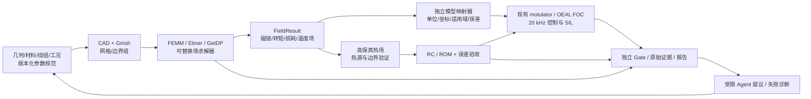

# P7：开放有限元与电机—控制—热—固件数字研发闭环（研究计划）

## 2026-11-08 长时反馈增量

[24,000s规定电流包络](p7-feedback-endurance.md)补充恒流/间歇热反馈、独立稳态矩阵、
恒流热稳定条件与时间细化，仍保持原热材料/源形状和冻结功率域。
长时实际FOC、强温升与热保护控制仍为后续工作，不由规定电流包络自动覆盖。

## 2026-11-08 温度反馈增量

[双向接口](p7-temperature-feedback.md)贯通实际FOC铜耗积分、同几何热ROM与下一窗电阻。
采用合成R(T)、整数窗口时钟、独立全阶热闭环、DOP853和双时钟细化，保留联合能量账。
50ms原型后续继续持续电驱/强温升验证、热保护接口和材料/接触/热源适用性研究。

## 2026-11-08 增量索引

[短时定子ROM独立版本](p7-stator-fast-rom.md)在原空间上加入固定短时算子方向，
本地33状态。12组原回放全场相对差≤1.188%，9组新h/波形留出≤2.946%，
两组长时回归及359测试通过。原22状态模型与预算保留；同离散精度不代替物理精度，
后续继续温度反馈接口、独立能量/时钟验收及材料/接触/热源适用性验证。

## 2026-11-06 增量索引

[同几何定子热场](p7-stator-thermal.md)已把有限元衍生电驱模型的铜耗送入
公开槽绕组几何上的热FE；[22状态参数ROM](p7-stator-rom.md)继续进行外圆换热
敏感性、训练冻结、独立h/波形留出与400Hz热回放。只覆盖合成热材料和
槽内均匀铜耗，未完成铁耗/端部/接触/转子、实物精度和控制反馈。
原P7 Gate保持，下阶段继续热材料/接触与不均匀源适用性，以及同机型控制反馈验证。

> 提出：2026-10-29；状态：**总体计划推进中；部分P7-A热/磁基准、P7-B合成电机提参/非线性磁图及公开有槽静磁链路与P7-D多速率联合已验证，完整工程数字线程尚未完成**。
> 上位目标：[总路线图](roadmap.md) · [现有软件架构](architecture.md) · [证据索引](stage-status.md) · [仿真交付范围](acceptance-scope.md)。
> 定位：与 ANSYS / Maxwell / Mechanical / Fluent 的**可证实、限定场景对比**，不是承诺全面替代 ANSYS，也不是重新开发通用有限元求解器。

## 1. 北极星目标与非目标

在开放、可迁移的 Python + AI Agent 研发环境中，以**同一台 PMSM/关节模组**为贯穿对象，构建可审计数字线程：

1. 参数化几何 / 绕组 / 材料与工况；
2. Gmsh 等开放网格，FEMM / Elmer / GetDP 等真实有限元求解器；
3. 电磁计算输出磁链、增量/割线电感、转矩/转矩脉动、反电势、可追溯损耗（仅在物理模型支持时）；
4. 把有限元结果映射至现有 OEAL 的 PMSM/FOC、motulator、关节和 FMU 模型，保留坐标、单位、温度、时钟和适用范围；
5. 将铜耗/铁耗/器件损耗按明确的物理热源映射到高保真热传导/对流模型，提取 RC/ROM（pyMOR 等）；
6. 验证 ROM 在目标计算环境下的 **400 Hz 在线状态更新**与 20 kHz FOC/SIL 的联合仿真接口（更新频率不等于温度估计准确度）；
7. 对照独立解析基准、网格/时间收敛、公开数据及**可获得且合法许可的**商业求解器结果，保留完整证据；
8. 基于冻结验收器，允许 Agent 提议设计/网格/工况，自动运行与修复，但**不得修改黄金数据或通过门槛**。

**目标不是：** 复制 ANSYS GUI、通用 FEM、全领域 CFD、整个 Simulink、宣称工业认证；未经真实样本不能声称结温预测达到物理实测精度。真机数据、PIL/HIL 由用户提供或执行，**不作为 P7 仿真交付前置条件**。

## 2. 现状与增量边界

截至本计划编写时，仓库已有 20 kHz FOC、原生/开源电驱、九状态关节、FMI/OpenModelica、连续六节点热网络、合成热参数辨识、受保护设计、C PI SIL/QEMU、证据和报告链。

**尚未验证：** Gmsh 生产级网格工作流、FEMM/PYLEECAN 与 Elmer/GetDP 的真实有限元接口、可复现电机 FE→FOC 参数链、实物几何的 3D 热/结构 FE、与 ANSYS 的同条件基准，以及 FE→ROM→400 Hz 在线模型的端到端误差/性能。

P7 必须作为**独立、可选、版本钉住的后端路径**逐项加入；不得把现有六节点合成 RC 模型或 FMI 模型重新命名为 FEM，也不得默默改变现有七种 IR 0.2 配置的默认语义。

## 3. 组件候选与决策方式

| 工程阶段 | 优先候选 | 首次纳入 | 重点评测与边界 |
|---|---|---|---|
| 参数化几何与 CAD | OpenCASCADE / FreeCAD | P7-A | STEP 与程序化几何、拓扑修复、单位与可复现性 |
| 网格 | Gmsh（Python API） | P7-A | 单元质量、网格密度、收敛和边界标记 |
| PMSM 2D 电磁 | PYLEECAN + FEMM | P7-B | 2D 非线性磁路、磁链/转矩/反电势；FEMM Windows/兼容环境依赖 |
| 电磁 3D/多物理 | Elmer / GetDP | P7-C 候选 | 非线性材料、旋转、涡流、热场、并行性能及工作流成本 |
| 纯物理FEM验证 | Gmsh + scikit-fem | P7-A首个基准 | 已验证原创二维稳态制造解；不代表实物热场或Elmer集成 |
| 热场 / 固液共轭换热 | Elmer；OpenFOAM（后续） | P7-C | 导热与温度相关参数优先；CFD 延后 |
| 结构与模态 | Code_Aster / CalculiX | P7-E | 接触、变形、模态与网格转换 |
| 控制及电机系统 | 现有 OEAL / motulator / FMI | 复用 | 不平行复制既有被控对象和求解器 |
| 降阶 / 在线估计 | pyMOR / SciPy | P7-D | ROM 误差界、推理性能、热源与边界变化 |
| 实验编排 / 多学科优化 | 现有 IR/Agent 工具；OpenMDAO 作为候选 | 按需 | 后端可替换、安全沙箱、预算与独立 Gate |

各候选先记录上游版本/commit、许可证/SPDX、分发与链接义务、可编程 API、安装环境、支持的物理模型、可替换性及复现命令，作出 `adopt / adapt / reference-only / reject` 决策。**Gmsh / GetDP 的 GPL 及例外条款、FEMM 的平台/分发约束、公开数据集的非商业限制，需要逐项审核；不能仅因代码公开就假定可商用。**

## 4. 数字线程与适配契约（建议；不得提前宣称已实现）

后续 IR 提案建议新增 *可选* `FieldExperimentSpec`/`FieldResult` 与 `ModelReductionResult`，在独立 ADR 和 JSON Schema 测试通过后才合入主 IR。最小证据字段：

- 几何/绕组/材料版本与 SHA256；坐标系、旋转正方向、极对数、相序、单位（SI）；
- 网格文件/单元类型/节点数/质量/尺寸分布及边界组；
- 求解器版本、构建/镜像摘要、数值容差、非线性迭代、时间步长、线程/CPU/RAM；
- 电流幅值定义（峰值/RMS、dq/相量）、激励相位、温度/磁化状态、位置/转速扫描；
- 原始场与计算得到的磁链/转矩/损耗，插值/拟合系数、非线性与温度适用范围；
- `source_kind` 区分 `analytic` / `synthetic` / `open_dataset` / `commercial_solver` / `physical_measured`；已有 `Evidence` 等级契约保持兼容；
- 独立验收器版本、固定阈值、失败记录、原始文件摘要、许可归属。

**物理注意：** `R_s` 主要由铜线几何、电阻率及温度决定，不可从单次静磁 FE 直接认定；`L_d/L_q` 应声明工作点和采用的割线/微分定义；反电势、平均转矩、转矩脉动及铁耗/涡流损耗必须使用各自适当的时间/运动/材料模型；磁链需统一三相↔dq 的幅值和变换约定；空间网格收敛不替代时间/耦合收敛。参数映射不能无条件以常数覆盖现有非线性磁图。

## 5. 可执行里程碑、冻结门槛和依赖

### P7-A：组件复现与纯物理基准（P0 优先级）

交付：候选许可证/环境 ADR、容器/Windows Worker 运行策略、Gmsh 参数化几何和最小网格样例、独立解析/制造解校验、可重跑的 CI smoke（外部大型依赖可采用单独工作流）。

**Gate A：** 从干净环境生成同一输入的网格与可追溯结果；验证单位和边界组；至少三档网格做收敛检查（验证误差趋势，不以“数值相同”作条件）；记录版本、CPU/内存、原始场文件与产物 hash。不得将只产生网格标为已完成 FE 求解。

### P7-B：同一 PMSM 的 2D 电磁场→FOC（首个核心 Demo）

交付：PYLEECAN/FEMM 真实求解器导入；电机参数/材料/绕组/激励固定；开路反电势、转矩/磁链/电感工作点扫描；导出带单位参数表；映射到现有 OEAL/motulator 的控制与动态模型。

**Gate B：** 附真实外部求解器运行证据、工况和至少三档网格/角步收敛；参数映射经过符号、单位和峰值/RMS 交叉测试；和独立参考/公开案例对照且**事前固定逐指标容差**；同一 PMSM 的 FOC 案例可复现，并有失败工况。不得将合成参数当作电磁 FE 的计算结果。

### P7-C：高保真损耗与热传导（随后）

交付：将铜耗/已建模铁耗/器件损耗按有符号、无重复热源映射到导热 FE；建立绕组/器件/PCB/硅脂/壳体的分区材料和接触热阻；至少一条与现有六节点热网络的独立参照。

**Gate C：** 原始损耗和热流积分能量守恒；至少三档网格、时间步收敛；热边界/接触热阻做灵敏度；无物理实测时仅宣称合成或公开数据集验证，不报告真实 MOSFET 结温精度。

### P7-D：ROM → 400 Hz 温度估计 → 20 kHz FOC/SIL

交付：有状态空间或 RC 网络的可导出 ROM、模型有效域、冻结训练/验证/留出拆分、400 Hz 热状态更新与 20 kHz 控制时间基准的同步接口；按计算预算测试宿主与目标可移植 C 参考（可选）。

**Gate D：** 独立留出温度轨迹 RMSE/峰值误差与全阶模型对照，事先冻结阈值；多温度、热源及接触热阻扰动的域内/域外失败样例；性能记录 p50/p95/峰值耗时与 CPU、内存；通过 SIL 不等于板端硬实时或物理结温精度。

### P7-E：可选扩展结构/CFD 与商业对比

交付：Code_Aster 的结构应力/模态，OpenFOAM 的共轭换热，仅在前几阶段通过后评估。商业 ANSYS Maxwell/Mechanical/Fluent 需要合法许可与同条件算例才进行实测比较。

**Gate E：** **同几何、材料、边界、求解目标、精度约束、CPU/线程、内存/硬件**对比；公开完整矩阵、误差/收敛曲线、墙钟时间和峰值内存，不以宣传速度声称优劣。缺乏商业工具访问时标记“待比较”，不阻塞开源模型自身验收。

## 6. 公开基准与实测数据的职责

优先研究 CREATOR 电机公开数据及其他合法公开的 PMSM 数据，评估几何、磁性材料、绕组、转矩/反电势/损耗是否足以复现具体试验。若数据采用 CC BY-NC 类限制，**研究中严格遵守条款，不能随意随仓库再分发或用于商业结果集**。引用原始作者、DOI、工况、版本与授权，不把“有公开测量”当作所有仿真预测均受实测验证。

验证分三条明确标签：**解析/制造解**（数学正确性）、**第三方求解器交叉比较**（数值一致性）、**公开或用户实测**（物理预测有效性）。依赖 ANSYS 的对照属于可选外部参照，ANSYS 不是唯一真值。

## 7. 风险清单与回退策略

| 风险 | 缓解/回退 |
|---|---|
| FEMM Windows 依赖或许可证不兼容 | 独立 Windows Worker；Linux/Elmer/GetDP 探针；不污染 Python 主包 |
| 电磁运动和铁耗建模不足 | 分离静磁/瞬态求解能力声明，不拼凑虚假损耗 |
| 多场映射误差、热源重复计入 | 明确控制体和有符号能量账，独立重算 |
| CAD/网格不可复现 | STEP + 几何脚本 + Gmsh 物理组 + 网格收敛 CI |
| 耗时/CI 不稳定 | 轻量解析与 smoke 每次 CI；HPC 长任务独立可重跑并锁版本 |
| 数据集非商用、材料参数不全 | 许可矩阵；不打包受限数据；不够数据则降级为理论/合成验证 |
| Agent 篡改门槛/执行未审查求解器输入 | 固定黄金测试、资源配额、可信后端白名单、沙箱与证据 hash |
| ROM 在热边界变化时失效 | OOD 检测/保守降额；留出失效工况；保持全阶回归参考 |

## 8. 近期执行顺序（可并行研究，不越 Gate）

1. **P7-A ADR + 求解器环境 PoC**：确定 Gmsh 与 FEMM/Elmer 许可/版本/安装策略，跑通最小独立 FE 验证。
2. **P7-B PMSM 工程对象**：对一个固定几何、材料和绕组完成 FE 参数导出及 FOC 接口映射，建立可复现基准矩阵。
3. **P7-C/D 热高保真→ROM**：在既有六节点 MSL 热网络和连续电驱上扩展，而不是推倒重来；区分真实 FE 与既有 RC 验证。

状态标注统一采用：`planned` → `reproduced` → `independently_verified` → `SIL_verified`，`physical_measured` 只能由实际测量证据产生；不可自动跨级升级。

本文件只规划集成方向和验收规则；**提交本计划不代表已运行有限元求解器、验证 ANSYS 对比、完成 ROM 400 Hz 性能测试或取得真实结温实测。**

## 9. 首个实施证据（2026-10-30）

[首个真实有限元基准](p7-fea-baseline.md)已通过固定网格/场误差/能量与报告验收，
使用Gmsh4.13.1 CLI、scikit-fem11.0.0和meshio5.3.5。
scikit-fem是新增的有限采用候选，原Elmer/GetDP/FEMM路线保留。
细网格温升L2相对误差0.2701%，三档接近二阶；完整证据见上述说明。
仅该制造解基准标记independently_verified；不将其扩展为整体Gate A或P7完成。

## 10. 双材料与混合边界增量（2026-10-30）

[分区基准](p7-layered.md)已完成三工况×三网格、独立分段解析解、
零源极限和标签故障验收；边界覆盖恒温/对流/绝热，保留环境入热符号。
这是P7-A纯物理验证深化，不是P7-C工程热模型完成。
局部界面重建功率差仍需改进，不能用温度二阶收敛或代数余额代替。
局部守恒通量后处理已新增，但全域精度仍待改善；工程边界/接触/瞬态/ROM及原电磁候选评测继续保留。

## 11. 局部守恒通量与精度取舍（2026-10-30）

[RT0后处理](p7-conservative.md)通过独立单元收支、法向迹、
故障、界面逐段RMS与全域L2门槛。原P1温度不变，属于部分P7-A增量。
界面误差显著改善，但九组合全域通量L2均比原梯度更差；
不得只宣传守恒或积分准确。
BDM1已在同一原温度数据下兼顾当前制造解的局部守恒和全域精度；
工程热模型与ROM仍需后续独立验收。

## 12. BDM1三方比较（2026-10-30）

[BDM1后处理](p7-bdm.md)已通过九组合局部/全域门槛，
原P1和RT0完整保留。最细异质全域通量误差降至0.01987%，界面局部RMS约0.0412%。
BDM线性边界迹和RT0面平均来源于同一原P1温度，但表示不同，报告已说明。
本基准更新为独立验证的部分P7-A能力；不是新温度后端或工程热场完成。
后续继续工程边界/接触/瞬态及降阶，同时保留原电磁候选和数字线程待办。

## 13. 有限接触热阻数学接口（2026-10-30）

[双材料接触基准](p7-contact.md)新增左右独立温度、有限面比热阻、
全局及子域收支、三档网格/热阻灵敏度与反向入热。
十二组合及三组零源极限通过冻结门槛；最细温升L2约0.011%–0.012%。
这是部分P7-A的理想稳态物理接口验证，尚无真实器件接触参数或P7-C工程损耗链。
下一步优先瞬态FE的独立时间参考、储能账和网格/时间步收敛，再进入ROM；
原FEMM/Elmer/PMSM与FE→FOC数字线程待办保持，不以该数学基准代替Gate B/C/D。

## 14. 瞬态储能与网格/时间步独立验证（2026-10-30）

[瞬态接触FE](p7-transient.md)增加一致质量矩阵、8s平滑热脉冲和8s冷却，
九组合及双容量/双时间缩放通过冻结门槛。
同FE模态时间阶数约2，独立1D有限体积空间参考下网格阶数约1.99，
最细五时刻温升RMS约0.0255%；离散能量和连续源积分误差分开。
报告可回放温度、两区储能、热源和散热状态，导出完整轨迹/M/K。
仍是y不变的理想合成基准，非工程Gate C或ROM Gate D完成。
下一步用导出模型推进pyMOR候选环境与冻结训练/验证/留出误差和计算预算；
原实际器件/电磁损耗/PMSM FE→FOC数字线程任务继续保留。

## 15. 首个FE→pyMOR固定模型与宿主预算（2026-11-02）

[14维降阶基准](p7-rom.md)实际调用pyMOR2026.1.1，
2145自由状态、两区能量增强、训练冻结后新验证/留出均通过。
留出相同时间离散全阶模型峰差2.02e−5K，不能替代连续/实物总误差。
Rc=.1→10失配被拒绝，反事实峰差0.853K且自身仍守恒。
单宿主更新加六输出p95=7.61μs、全场重建另计，均保存逐样本耗时。
这只完成Gate D的一部分：固定参数、已知源和初态、离线验证及宿主预算；
多温度/接触参数化、导出推理接口、400Hz状态与20kHz控制的真实时钟同步仍待验收。
原工程器件/电磁损耗/PMSM FE→FOC任务继续保留，整体P7未完成。

## 16. 接触参数化与独立NumPy推理（2026-11-02）

[22维参数ROM](p7-param-rom.md)以Rc=.01/.1/1六组训练冻结，
仿射更新Kbulk和接触C，六个新Rc点误差/能量/时间细化均通过。
最大对同离散FOM节点差3.31e−5K；原固定基线0.18–0.88K，
但训练覆盖/维数/算子共同变化，不作单因素结论。
NumPy-only接口实际拒绝越界Rc/非法数据，输入拒绝不改状态，
宿主真实step p95为26.7–27.9μs，六参数各5000样本。
两域外反事实数值误差小仍按冻结范围拒绝，避免事后扩域。
仍仅每轨迹恒Rc、固定材料/环境和已知源，精度证据是离散工况而非连续域误差界。
下一步推进400Hz热接口与20kHz控制的多速率时钟/热源契约；
原工程损耗/器件几何/PMSM电磁数字线程任务不被该增量替代。

## 17. 实际电驱多速率源能与温度反馈（2026-11-02）

[20kHz/400Hz联合](p7-multirate.md)复用固定motulator和既有FOC，
真实RHS铜/桥J按整型50周期窗口传递，新增均值输入API避免重复平均。
四组各5000控制命令，400Hz100热更新、800Hz200热更新，终端不多发命令。
同源FE重放、20k热ROM重放、实际400→800Hz联合细化、冻结R因果对照和回馈均通过。
发现原平均桥方向锁存的负耗散并保留失败证据；经先行反例和明确平滑方向刷新适配后通过。
这使Gate D的仿真事件时钟/多速率接口得到实际证据，仍非wall-clock硬实时、器件测温或完整固件。
热模型仍是合成等效板，工程几何/真实电磁损耗空间映射、PMSM FE→FOC与更长时/多电气工况继续保留。

## 18. 两秒负载/制动冷却及暖状态续跑（2026-11-02）

[四工况联合验证](p7-drive-cycle.md)覆盖2s实际电驱、40000控制命令、
外部机械制动/余热冷却、800Hz细化与冻结R对照。
两个非热窗暂停点保留3/27个周期，PI/热状态及全量受检轨迹相对连续运行差为0。
1→2s基准板储热下降18.84%，终速7.52e−10rad/s；全部源能、局部余额及同源FOM门槛通过。
零热末窗仍必须更新冷却状态；故障能量检查使用真正有热的窗口，末窗另验计数/终点。
报告提供抽样回放、12份全量CSV及独立RHS/全场原始包。
这是部分P7-D的有限时域状态持续性证据，不是进程恢复、关栅保护、长期耐久或硬实时。
下一步仍需工程几何/真实电磁损耗映射与PMSM FE→FOC核心链路；
参数/环境变化的可迁移热状态、跨进程恢复和完整控制SIL分别验收，不由本轮自动升级。

## 19. 电磁基础：Az、方向/规范与有单位电感（2026-11-02）

[磁静态基准](p7-magnetic.md)新增真实scikit-fem磁阻装配与Gmsh材料/电流标签，
12工况/网格、独立Ampere解析场、磁能/磁链及单匝L提取。
最细L误差≤0.07362%，B全场误差≤2.7200%；两者不混为同一精度。
固定对角线粗网格界面5.37555%失败保留；交替网格在原5%门槛下通过，
旧默认几何网格hash及双材料热回归不变。
反向/倍流/零源/规范和三类故障均验收，报告显示完整场状态与原失败。

这是部分P7-A的磁静态独立验证，不是Gate B完成；
导出的有限矩形单匝L不被映射成PMSM Ld/Lq。
下一核心任务应推进具体PMSM的永磁体/槽绕组/材料/转子位置与边界，
以及FEMM/PYLEECAN或Elmer/GetDP候选的实际可复现求解，
再按冻结幅值/相序/转矩与磁链约定接入现有FOC；
工程损耗空间映射、完整控制SIL、实物/ANSYS对照继续保留。

## 20. 首个实际FEMM电机→冻结参数FOC（2026-11-03）

[真实FEMM链路](p7-femm-motor.md)已完成有限圆域永磁圆柱解析探针，
以及原创线性无槽两极模型的三档网格/243个静态场、
磁链、电感、相序/峰值约定、应力/虚功与细化验收。
ψ=0.02602778 Wb，Ld/Lq≈31.3056 μH；
冻结JSON进入既有motulator平均模型，±0.5 A FOC均通过。
R/J/摩擦为独立指定参数，未从FE提取。
最终227测试通过、12跳过，离线报告机制/场状态/控制/14CSV验收成功。

原h2粗网格MST31.5%失败与径向积分21.5%失败完整保留；
在冻结更细网格后按原门槛通过，恢复B误差非单调。
原场通过但FOC配置错误的运行只复用场阶段：
最终逐文件、参数散列和生产源码身份验证后新跑FOC，
原失败FOC不被接受或缓存为成功。
FEMM/pyfemm的AFPL采用边界与原生程序不分发规则独立记录。

该增量使部分P7-B的实际求解器→参数→控制链有了证据，
不把合成无槽模型升级为完整Gate B或整体P7完成。
下一核心工作为工程槽绕组/转子、非线性材料与磁图、
独立求解器/公开基准、反电势和有物理依据的损耗；
然后推进同一电机损耗到工程热FE/ROM的空间映射。
既有合成板热ROM、完整FOC固件及跨进程恢复分别保持原验收范围。

## 21. 合成饱和材料与二维dq磁图（2026-11-03）

[真实非线性磁图](p7-femm-nonlinear.md)已完成均匀材料独立B/H基准、
两档25点训练地图冻结、独立留出、局部增量/细化、角度与配对线性检查。
最细Ld/Lq≈29.4893/31.1690 μH，留出峰值磁链差1.382 μWb，
两网格训练磁链差/0.026Wb最大0.001070%；全部原数值门槛通过。
矩阵只代表零电流邻域，静态双线性查询不自动成为动态被动磁链模型。

单个细点约95s，原串行作业取消后改为分行训练、完整冻结再验证；
未更改物理、网格或阈值。184原生模型/解与失败日志保留。
新离线报告通过82状态、11下载、390px、五图/PDF验收；
数值和展示源码身份分开，重建先验证409原始文件及生产者未变。

该增量仍为部分P7-B，不满足完整Gate B的工程对象、
三档/角步完整收敛、公开独立PMSM对照及同模型非线性动态FOC。
下一步优先工程槽绕组/转子与真实材料来源、公开/独立场基准，
再验证有适用域和能量一致性的非线性控制映射、反电势及可追溯损耗；
既有合成板ROM仍不代表同一电机温升，工程热映射继续独立推进。

## 22. 公开有槽模型与PYLEECAN真实执行（2026-11-03）

[12槽8极SPMSM_001基准](p7-pyleecan.md)实际使用固定PYLEECAN/SciDataTool/SWAT-EM，
原始公开JSON/许可证/源码身份与官方FEMM安装包、exe散列完整归档。
三网格、正负明确abc激励、指定转角与双叠长共12解，全部固定门槛通过。
原生1m深度到50/100mm物理叠长逐点与库输出核验；
上游零角哨兵导致的首次周期失败保留，先修订实际22.5°基准后全量复算。

这推进了Gate B公开有槽对象与实际库工作流，但不代表独立公开数值/实测精度：
原材料测量出处未确认，轴向磁体参数不一致，当前仅2D静磁。
三网格磁链/转矩预算通过不替代全角度收敛或齿槽转矩精度，
本模型尚未接入此前合成无槽FOC；其dq零点必须另行标定。

下一核心次序：同机型绕组/坐标与开路角扫、角步/网格收敛和反电势，
独立PMSM数值参照、能量一致非线性动态接口，
再推进有物理依据的损耗与同一工程电机热FE/ROM空间映射。
现有合成板ROM、多速率和暖续跑保持各自范围，完整固件SIL与跨进程恢复继续单独验收。

## 23. 同一公开电机：角扫描与开路准静态电压（2026-11-03）

[角度扫描](p7-pyleecan-angle.md)对同一公开机型做三网格各13个实际静磁解，
按明确机械坐标与叠长计算三相λ和e=−ωm dλ/dθm。
细网格600rpm离散样本绝对峰值15.9592V；中→细电压差最大0.01527V。
7.5°与15°角步差最大1.82619V，保留原定预算和实测差，不能以网格一致替代角步精度。
三相基波相位约0/−119.99847/+119.99888°，但尚未映射现有控制器dq零位。

这是开路磁静态序列后处理，不是运动时步、负载反电势、动态FOC或损耗。
此前细网格下载失败与镜像重试、来源/哈希及失败范围独立记录。
继续更细角步/角域留出、同机型坐标标定与能量一致的动态接口，
补充独立PMSM场参考和同机型损耗到工程热FE/ROM；不将这一增量升级为完整Gate B。

## 2026-11-04：公开电机角步由7.5°细化至3.75°

[方法与实际证据](p7-angle-refinement.md) / [离线报告](https://github.com/lse872317312010/open-engineering-agent-lab/actions/runs/41764534832/artifacts/13292001945)。
同一细网格新增12个中间角真实场，与已核验旧点构成24角周期。
共同角度电压差由上一轮1.82619V降至0.696911V，差值缩小2.6204倍；
600rpm离散峰值16.30349V。全部固定门槛、237项原生环境测试和正式浏览器检查通过。
202个manifest条目与新旧50份原生文件核验；复用与新求解来源逐点保留。
差值改善不等于连续/实物精度或收敛阶，仍为部分P7-B准静态开路序列。

## 2026-11-04：公开电机开路dq零位与留出验证

[方法与冻结证据](p7-dq-calibration.md) / [交互报告](https://github.com/lse872317312010/open-engineering-agent-lab/actions/runs/41773934220/artifacts/13295853792)。
仅用旧12角拟合正向p=4电角零位，冻结后用新增12中间角验证；保留零序及实际q残差。
δ=−3.0698798e−5rad，训练幅值0.06548295Wb，留出最大q残差0.302232mWb，
d偏差0.107709mWb，abc往返差1.39e−17Wb；解析交换B/C反例被拒绝。
226测试通过37可选跳过；正式浏览器24角/CSV/390px验收通过。
这是开路坐标标定，主控制器尚未接入，非带载磁图、动态FOC或实测精度。

## 2026-11-04：公开电机带载dq方向与转矩

[方法与真实结果](p7-loaded-frame.md) / [交互报告](https://github.com/lse872317312010/open-engineering-agent-lab/actions/runs/41806414795/artifacts/13310346005)。
固定开路零位，两个机械位置各五种dq电流，共10个新FEMM非线性静态解。
原始电路回读参与dq核对；±2A q轴增量转矩方向正确，纯d轴转矩变化≤4.25e−5Nm。
FE增量与dq近似最大差0.033731Nm，位置相关差异完整保留。
原生251测试通过25可选跳过；正式报告239通过37跳过，10状态/CSV/390px验收通过。
两个44项manifest及20原生文件核验；仍为静态低电流接口验证，动态FOC/全磁图/损耗和工程热映射继续推进。

## 2026-11-05：公开电机局部磁链模型与冻结留出

[方法和范围](p7-local-flux.md) / [交互报告](https://github.com/lse872317312010/open-engineering-agent-lab/actions/runs/41947340580/artifacts/13379910369)。
只用0°五个真实带载点拟合ψ和对称正定L，冻结后评价22.5°五点。
Ldd/Lqq约1.12057/1.35461mH，留出最大磁链向量差260.94μWb，
对FE增量的近似转矩差≤0.0337701Nm；原始互易残差与零流q磁链均保留。
245测试及正式浏览器验收通过，输入域外拒绝。
本轮重新核验旧场而无新FE求解，模型只覆盖已声明局部静态范围，动态FOC未接入。

## 2026-11-05：冻结局部模型进入锁转子电流环

[方程、参数与真实积分结果](p7-locked.md) / [交互报告](https://github.com/lse872317312010/open-engineering-agent-lab/actions/runs/41975506070/artifacts/13391706312)。
复用既有PI/坐标变换/平均SVPWM，保留完整2×2电感矩阵；固定角度/零速，电阻0.3Ω单独指定。
正常与欠压各40ms、800控制命令、801端点；正常稳定段iq误差≤71.71μA。
矩阵指数同电压重放、5/2.5μs细化与能量均通过；欠压780次限幅，最大稳定误差0.1784A，明确未达跟踪目标。
259测试、八项CI及正式浏览器检查通过；原模型SHA不变，无新FE求解。
这是合成锁转子电流环验证，未完成旋转FOC、动态物理精度、完整固件或工程热映射。

## 2026-11-05：局部模型的外部恒速旋转扩展

[方程、假设与结果](p7-rotation.md) / [交互报告](https://github.com/lse872317312010/open-engineering-agent-lab/actions/runs/41978284329/artifacts/13393080706)。
明确假设冻结局部dq模型转角不变，外部施加±300rpm，既有20kHz PI/SVPWM与完整ωJλ耦合进入动态RHS。
正常各60ms/1200命令/1201端点，最大稳定iq误差约16.2μA；独立增广矩阵指数、半步长和源/铜/轴/储能余额通过。
欠压6V在约0.595ms积分阶段离域拒绝，保留12命令、13有效轨迹点及首个非法阶段，不裁剪继续运行。
261测试、八项CI和四工况浏览器验收通过。
无新增FE；原带载仅两角验证，合成延拓的数值结果不构成全角度动态物理精度认证。真实机械ODE、完整固件及工程热映射继续推进。

## 2026-11-05：实际带载八角与冻结模型留出

[方法与实际结果](p7-angular.md) / [交互报告（1.74MB）](https://github.com/lse872317312010/open-engineering-agent-lab/actions/runs/41985661797/artifacts/13396280327)。
固定ψ/L与dq零位，新增六角×五电流=30个真实FEMM解，与原10例组成八角40点。
新六角不参与拟合；5训练、5原留出、30新留出的角色和来源逐点保留。
全部通过原预算，最大磁链向量差397.879μWb（预算1mWb）、转矩增量差0.0337701Nm（预算0.10Nm）。
八包各44项manifest、80份原生fem/ans完整核验；证据完整性和模型支持分别判定。
报告254测试通过/37可选跳过，浏览器40状态、三种精确下载、390px验收通过。
这是离散静态角点证据，仍未认证连续角域、带载角步/网格收敛、独立物理精度或完整Gate B。
下一步推进混合dq电流/幅值留出及细化，再判断角度相关动态接口与同机型损耗热映射。

## 2026-11-05：混合dq电流与幅值留出

[方法与结果](p7-current-holdout.md) / [交互报告](https://github.com/lse872317312010/open-engineering-agent-lab/actions/runs/41992584303/artifacts/13399460757)。
四角新增32个真实FEMM解，覆盖±0.5A单轴及(±1,±1)A混合电流；与20个核验旧锚点共52例，固定模型未重拟合。
新增32点均通过，最大磁链差380.296μWb（预算1mWb）、转矩增量差0.01755165Nm（预算0.10Nm）。
全部52点也通过；原生/旧证据重验、篡改/缺点/错来源反例、254测试及52状态浏览器检查通过。
离散静态通过不代表连续电流域、带载网格/角步收敛、动态FE或完整Gate B；真机由用户负责。

## 2026-11-05：公开电机带载三档网格敏感性

[方法与结果](p7-loaded-mesh.md) / [交互报告](https://github.com/lse872317312010/open-engineering-agent-lab/actions/runs/41995793750/artifacts/13400123591)。
四角四电流、三档网格共48工况，其中32个粗/中网格为新FEMM解，细网格16点经核验复用。
16组均通过预算，中→细最大磁链差67.205μWb、最大绝对转矩差0.0024973Nm；同网格零流扣除后的增量转矩最大差0.0016043Nm。
全部节点逐档增加；两次差值及非单调标记保留。257测试及48状态浏览器验收通过。
这是离散2D静磁网格敏感性，不是连续角/电流、动态场或实物精度认证。带载角步和同机型动态接口继续推进。

## 2026-11-05：带载角步细化、网格复核和角度相关控制接口

[方法、失败记录和完整证据](p7-angle-dynamics.md) / [交互报告](https://github.com/lse872317312010/open-engineering-agent-lab/actions/runs/42004300771/artifacts/13404795726)。
连续新增140个真实FEMM场（含8个中点网格复核），复用并审计旧场；带载绝对转矩与零流扣除增量分开。
零流/+2A相同两种工况的四级中点最大绝对转矩差为1.9373、1.0105、0.2985、0.08293Nm；前三级未达0.10Nm预算，最细级64点全部通过。
四中点两档网格最大转矩差0.002219Nm，不能替代实物或独立场参照；固定局部模型在首级36点的增量预算通过。
角度相关ψ与固定L接入既有20kHz PI/平均SVPWM，正反转、矩阵指数重放、半步长、能量和欠压离域拒绝通过；零流齿槽转矩及真实机械动态未建模。
275测试通过/25可选跳过，报告验200个场选择状态、18个动态/控制状态及20种精确下载。
仅为离散2D静磁与合成动态证据；连续域、物理精度、完整Gate B及工程热映射仍待完成，真机由用户负责。

## 2026-11-05 已完成增量

利用 FEMM 原始静磁解建立角度相关齿槽转矩与共能模型，并增加留出工况验证、原生共能和应力转矩对比、机械—电流控制仿真与可交互报告。见 [齿槽转矩与共能结果](p7-cogging-coenergy.md)。完整动态有限元、独立求解器对照、损耗与热映射仍是后续研究内容；真机不阻塞仿真交付。
