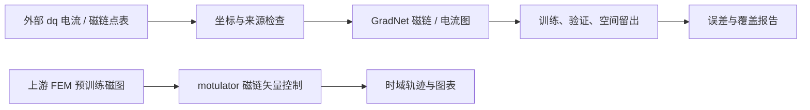

# P8 公开磁图与控制实验进展（2026-11-18）

## 已完成的流程

外部点表 → [CSV 导入器](p8-open-point-import.md) → motulator-gradnet 磁图拟合 → 空间分区误差评估。另有独立的上游 motulator 电机和磁链矢量控制例程，使用上游预训练 FEM 模型。两条流程当前没有在同一电机模型上接通。

电流点表采用峰值安培，磁链单位 Wb。未知温度在元数据中为 null，并提供说明；坐标、相序与有效域需要数据来源说明。用户的实际电磁软件格式及数据尚未验证。

## 磁图空间分区结果

同一上游 Baldor 公开测量点集，预先排除验证区间 −4 ≤ id ≤ 4 A；其余点中 |iq| ≥ 16 A 的正负两侧留出，其余训练。两轴 GradNet 通过上游工具各训练 2000 轮。上游映射对 q 轴做对称化，正负两侧必须同时留出，避免反号点泄漏。

| 分组 | 点数 | 磁链向量 RMSE | 电流向量 RMSE |
|---|---:|---:|---:|
| 训练 | 240 | 0.04222 Wb | 0.5219 A |
| 验证 | 135 | 0.21849 Wb | 2.9766 A |
| 高 q 留出 | 192 | 0.34859 Wb | 5.4284 A |

[运行证据、分区图、数据和模型](https://github.com/lse872317312010/open-engineering-agent-lab/actions/runs/44058030279/artifacts/14317298539)；ZIP SHA-256：67d4b008cdbd002eff5ead257bf8e9c5000ca07f9e33960b3d5f1fc0af006e4a。图表和文件由 GitHub Actions 保存，下载需要仓库权限且有保存期限。

训练集误差明显低于空间留出，说明此设置下向未覆盖区域推广存在较大误差。实验没有预设误差门槛，现阶段不适合把这组拟合模型作为控制仿真的可信电机模型。此前探索训练使用过本次部分留出点；该分区不是整个研究过程未接触过的独立盲测，也不代表物理实测或商业软件对标。

## 已验证的插值对照与有效域

[误差地图、逐点数据与完整对照](https://github.com/lse872317312010/open-engineering-agent-lab/actions/runs/44225336908/artifacts/14394922014)；ZIP SHA-256：7d3e2330e031e7bd75b453b70977515cb87cb325354bdf2a2a5f97ce58537ed8。

同一验证集内，75 个点在电流训练凸包内：磁链向量 RMSE 为 SciPy 线性插值 0.02452 Wb、GradNet 0.04213 Wb。65 个点在磁链训练凸包内：电流向量 RMSE 为 SciPy 0.83590 A、GradNet 0.64684 A。两行的点集不同，只能分别比较每行内的两个方法。192 个高 q 留出点全部在两个训练凸包外，SciPy 不作外推，因此没有该区域的同点对照。这是单一数据与固定分区的结果，凸包为几何覆盖，不能保证物理精度或积分阶段安全。

## 凸包内条带诊断（已合并）

在同一公开样本中，固定留出正负 q 轴电流条带，比较两种开源方法的相同点。该数据已参与此前探索，本实验不构成独立盲测；[实验 PR 与完整数据](https://github.com/lse872317312010/open-engineering-agent-lab/pull/84)。

| 区间和数量 | GradNet RMSE | SciPy 线性插值 RMSE |
|---|---:|---:|
| q 轴电流幅值 = 6 A，磁链，42 点 | 0.01359 Wb | 0.02779 Wb |
| q 轴电流幅值 = 6 A，电流，40 点 | 0.46694 A | 0.62368 A |
| q 轴电流幅值 = 14 A，磁链，42 点 | 0.01156 Wb | 0.004817 Wb |
| q 轴电流幅值 = 14 A，电流，40 点 | 0.84968 A | 0.19175 A |

插值和 GradNet 在两个条带的相对表现不同；这些点不能推断所有转速、电流或温度下的精度。该实验专用运行和关联检查已完成，实验代码已合并；尚无独立盲测或物理精度结论。

## 上游电机—控制联合示例

[motulator 上游 FEM GradNet 示例结果](https://github.com/lse872317312010/open-engineering-agent-lab/actions/runs/44058329790/artifacts/14318067520)包含 1.75 s 控制轨迹、图表、模型与版本信息，共 28002 个轨迹样本。ZIP SHA-256：6d2080ffe98040f8c08241fe73e3bd63ab0f33bb201d7473df169fa708132185。此示例使用上游预训练模型，运行成功仅说明该上游组合可执行，不能证明本项目导入的数据已接入控制器或达到物理精度。

## 接下来

- 对比上游模型与插值方案在相同训练区域、相同留出区域的误差与计算开销，报告域内/域外点数。
- 在满足预先声明的误差预算和有效域条件后，把由用户模型训练得到的磁图接入 motulator 控制实验。
- 用独立有限元求解点或授权的实测数据校验磁链、转矩及必要特性图；损耗数据不足时不生成完整效率结论。
- 保留理想平均逆变器范围。最终报告增加电机特性、模型组件状态、误差地图与可导出的轨迹。
